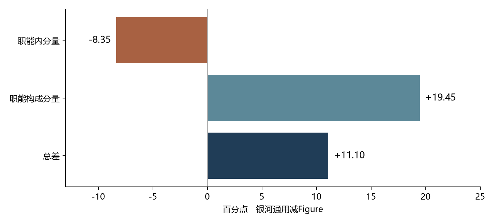
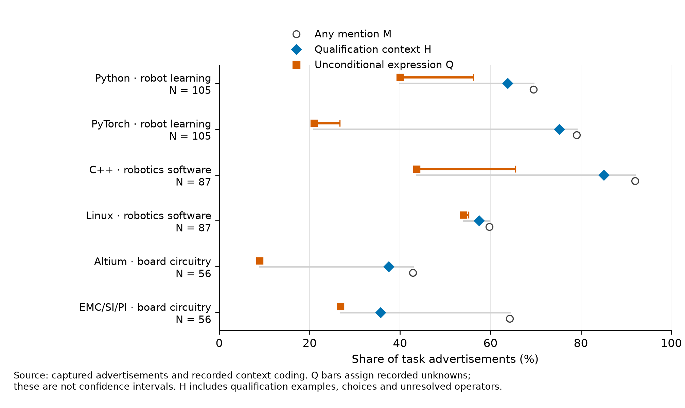

# 研究内容与主要发现

## 研究问题：从公司招聘构成到技术资格

具身智能同时涉及模型、软件、机械、电气、制造、现场交付和持续运行。企业的招聘广告提供了一种观察窗口：公司正在公开招募哪些工作、这些工作面对哪些对象，以及企业如何向候选人表达技术经历和能力要求。

本研究的第一层问题是：**具身智能企业怎样通过招聘组织职能与工作活动，公司之间的差异来自哪里？** 为此，研究构建了覆盖 24 个招聘主体、1,654 条广告的语料，保留主体范围、来源、岗位身份与文本版本；按主要交付划分职能，另行识别研究、工程和质量活动，进一步标注工作对象与技术表达。

第二层问题由第一层分析引出：**广告写到某项技术时，我们应该把什么计作技术资格？** V4 英文论文将这一问题集中到同一广告中的技术比较。相同岗位、相同文本和相同任务层，可以在不同资格定义下产生不同的技术排序。

这两层形成一条连贯研究路线：先确定企业公开招聘的是哪些工作，再考察这些工作怎样表达技术责任与资格。

## 数据：24 个主体、两个采集批次

2026 年 8 月 31 日采集的第一批包括 8 家企业的 610 条广告；9 月 11 日的第二批新增 16 个主体、1,044 条广告。23 个主体采用整公司招聘范围，共 1,630 条；Amazon Frontier AI and Robotics 单独作为团队，共 24 条。主体名单与范围见 `broad_study/inputs/stage_c/tables/T1_company_sample.csv`。

每条广告以复合身份连接公司、来源岗位 ID 和文本版本。公开包保存可读广告正文、职责、资格字段，以及用于判断的原句和位置。同名岗位、相同阅读编号和相同正文仍可能具有不同来源岗位身份，因此按照完整身份连接数据。

全部语料保留主职能结构，1,576 条广告进入 17 个具体职能的资格目录分析；其中整公司范围为 1,552 条。目录包含 354 个条目，覆盖技术对象、工具、工程方法和操作资格，并按职责与资格语境划分为 22 个格。

|主职能|广告数（全 24 主体）|
|---|---:|
|制造、质量与供应链|215|
|软件与平台|181|
|ML/AI 工程|159|
|公司支持|132|
|硬件与电气|126|
|商务与客户|117|
|产品与项目|106|
|机械与机电|91|
|部署与现场服务|85|
|控制与规划|75|
|数据与分析|72|
|仿真、评测与测量工具链|62|
|感知|47|
|研究科学|32|
|系统工程与跨域集成|31|
|工业与体验设计|23|
|机器人操作|22|
|合计|1,576|

## 方法：把工作归属、责任关系和资格方式展开

**主职能与活动分别编码。** 主职能由岗位的主要持续交付确定；活动允许多标签。因此，一个软件岗位可以同时承担研究和验证工作，一个制造岗位也可以有工程开发活动。研究由此观察组织分工在职能内部与职能之间的分布。

**任务与工作对象由职责确定。** 原研究另对四家企业的 84 条 ML 与软件广告分析模型、数据、基础设施、机器人软件与履约流程等工作对象。模型、数据和基础设施可能共同出现。产品归属不足的广告保留未确定状态，以工作原文支持岗位比较。

**技术表达保存关系。** 同一术语可能出现在本人使用、开发对象、参与协作、一般要求、明确必备和优先条件中。任选、示例或条件关系也一并保留。正例、无正例、未知、目录不适用和来源不足分开记录。

**公司比较采用构成分解。** 对 Galbot 与 Figure 的四个共同职能，研究分解工程活动总体差异，区分“职能份额不同”与“相同职能内部活动比例不同”。四个共同职能为公司支持、制造／质量／供应链、ML/AI 工程、软件与平台。

**V4 在相同广告中配对技术。** 机器人学习／模型开发层有 105 条，比较 Python 与 PyTorch；机器人相关软件层有 87 条，比较 C++ 与 Linux；板级电路层有 56 条，比较 Altium 与 EMC/SI/PI 工程方法族。每条广告对应两个目标，合计 496 条记录。

V4 采用三个文本层：

|层次|判断内容|例子|
|---|---|---|
|M：提及|广告职责或资格中明确出现目标技术|“开发 PyTorch 模型”|
|H：资格语境出现|一般或必备资格语境中出现技术，保留其所受关系|“熟悉深度学习框架，如 PyTorch”|
|Q：无条件技术特指资格|一般或必备资格中，无任选、示例、条件或未解范围的目标技术表达|“熟悉 PyTorch”|

Q 的确认正例包含在 H 中，H 包含在 M 中。Q+E 将已记录的示例关系纳入，Q+C+E 再将任选关系纳入；优先条件仍独立。不同计数规则回答不同的资格问题。

每个资格规则分别保留 P（正例）、Z（该规则下无正例）和 U（未解）。对固定广告基数 B，确认份额为 P/B，未知状态赋值范围为 `[P/B, (P+U)/B]`。技术 a 减 b 的差值范围为 `[(P_a−P_b−U_b)/B, (P_a+U_a−P_b)/B]`。

计算进一步采用共同提及子样本、公司等权、同公司完全相同资格文本权重、局部父句模板权重和逐一剔除公司。对七组耦合语义判断枚举 128 种已记录读法；公司排序另计算多少次已判定状态变化会使方向失去支持。后续加入同类技术 PyTorch—TensorFlow 的探索性比较。

## 发现一：研发和质量工作分散在多种职能中

研究活动的 66 条正例中，48 条位于研究科学以外的主职能，占 72.7%。宽口径质量活动的 459 条正例中，300 条位于制造、质量与供应链以外，占 65.4%。后者包含验证、发布、合规和缺陷闭环等工作。

这些结果说明，公司的研究与质量能力分布在多类岗位中。招聘结构可以同时显示专业职能和跨职能责任，单看“研究员”“质量工程师”等名称会遗漏一部分工作。

## 发现二：职能构成会改变公司比较的方向

在四个共同职能的活动可判断广告中，Galbot 共 82 条，Figure 共 60 条。工程活动占比分别为 56.10% 和 45.00%，差 11.10 个百分点。

|比较项|Galbot−Figure（百分点）|
|---|---:|
|共同职能内的总体工程活动差异|+11.10|
|职能构成贡献|+19.45|
|职能内部贡献|−8.35|
|四个职能等权后的差异|−9.16|

Galbot 招聘组合对工程活动较密集的职能赋予了更高权重；在相同职能内部，平均差异方向相反。去明确实习／校招和职责文本完全相同模板后，两类贡献仍方向相反。构成分解使公司比较具有明确的工作基础。

## 发现三：技术资格排序受语言关系影响

在 105 条机器人学习广告中，PyTorch 比 Python 更常被提到（83 对 73），也更常进入一般／必备资格语境（79 对 67）。无条件技术资格却由 Python 领先：42 对 22，即 +19.0 个百分点；未知赋值范围为 +13.3 至 +35.2。

加入全部已记录示例后，Python 与 PyTorch 为 43 对 65，差值变为 −21.0 点，范围为 −24.8 至 −4.8；再加入任选，成为 50 对 75，差 −23.8 点。

从 Q 到示例扩展，有 44 次确认正例增量，43 次属于 PyTorch、1 次属于 Python。其中 17 次具有明确示例提示词，25 次涉及“等”式开放列表，另有 2 次为未标记括号列表。这使框架资格的例示方式成为排序变化的重要来源，也让不同示例规则有可检查的原文基础。

## 发现四：同一广告中的比较也需要明确资格定义

66 条广告同时提到 Python 与 PyTorch，H 的数量为 60 对 62，差距很小。Q 为 37 对 18，Python 领先 28.8 个百分点；未知赋值范围为 +21.2 至 +51.5。加入示例后成为 38 对 51，范围 −24.2 至 +3.0。

公司等权、完全相同资格文本权重与局部父句模板权重均保留 Q 的 Python 领先方向。它们支持这一结果在当前语料中的计算稳定性；示例扩展则表明所计资格关系仍会改变结论。

## 发现五：其他技术对照呈现不同结构

87 条机器人软件广告中，C++ 的提及与资格语境出现都更多，分别是 80 对 52、74 对 50。Q 正例则是 38 对 47，Linux 更多；全任务层的已记录未知范围跨过零。48 条共同提及广告中，Q 为 26 对 44，差值范围 −39.6 至 −4.2。

56 条板级电路广告中，Altium 与 EMC/SI/PI 的提及数为 24 对 36，H 为 21 对 20，Q 为 5 对 15。设计工具更多作为候选工具写进资格；工程方法也经常作为职责出现。因此，技术名字的数量需要结合工具或方法在工作中的角色理解。

探索性同类比较显示，105 条机器人学习广告中 PyTorch 被提到 83 次、TensorFlow 26 次，但 26 条共同提及广告内，两者各资格规则的确认正例数相同。这个对照提示，解释 Python—PyTorch 的变化时，应考虑技术类别及其常用表达方式。

## 发现六：有限的公司样本限制排序稳定性

公司比较在每项可判断广告至少 10 条的门槛下只形成 3 组，均属于 Galbot 与 X Square；在至少 5 条的门槛下形成 32 组。后者的 5 组严格方向反转中，4 组在一次不利的已判定状态变化后即失去支持，第 5 组在两次后失去支持。

这部分结果将“比例方向”与“排序稳定性”分别量化。当前研究最有力的技术发现来自同广告、同任务的资格构造比较；公司排名宜结合样本量、关系原文与变化距离一起读。

## 研究的用途

对于劳动需求与人力资源研究，本项目提供了一套从公司范围、广告身份、工作内容到资格关系的可追溯结构。研究者可以区分公司构成和职能内部差异，也可以明确技能指标究竟计入直接资格、可替代项还是示例。

对于招聘实践，研究说明必备、一般、优先、任选和示例的写法具有实质信息。把可接受的替代经历和具体技术要求表达清楚，有助于候选人判断岗位准入条件，并减少仅凭关键词推断技能门槛的偏差。

## 研究范围与已修正事项

结论针对目的性采集的企业招聘广告。两批数据记录的是两个横截面；编码采用模型辅助阅读，尚无独立人工双编码信度；未知范围处理已保存的歧义。原研究的部署活动标签曾混用不同工作对象，相应主结论已经撤回，其历史表和撤回理由仍保留。全样本报告提供组织与职能研究，V4 提供最新技术配对结果；较早论文用于版本追溯。
