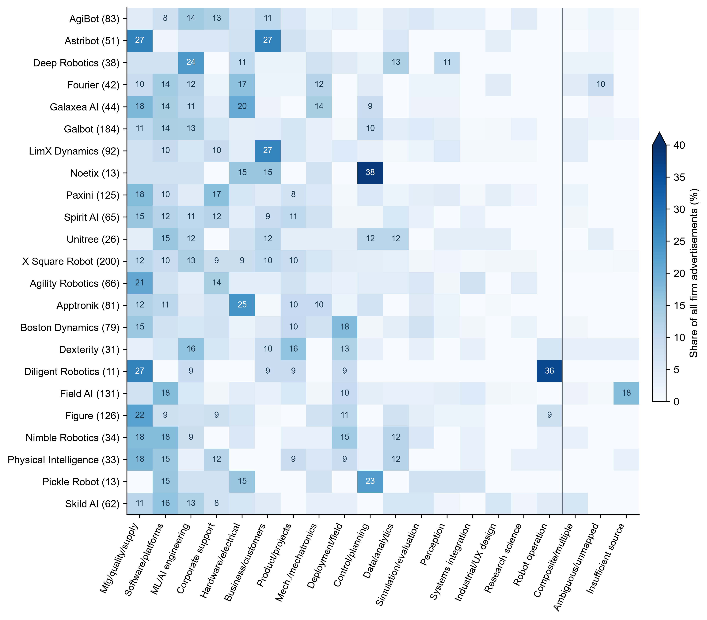
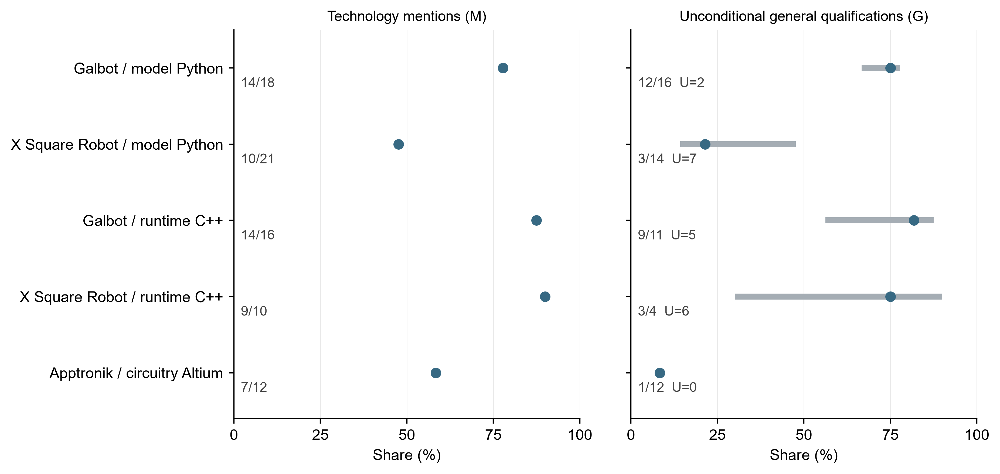

# Work Composition and Technology Requirements in Embodied AI Job Advertisements

**Purpose:** This paper asks how comparisons of embodied artificial intelligence (AI) recruitment change when primary job functions, work objects and the semantic status of technology references are measured separately.

**Design/methodology/approach:** The descriptive analysis uses 1,654 public job advertisements from 24 entities, with 1,630 advertisements from 23 whole-firm recruitment boards as the main sample. It links function and activity coding to three task-specific technology comparisons.

**Findings:** In four functions shared by Galbot and Figure, an 11.10-percentage-point engineering-activity gap decomposes into a +19.45-point function-composition component and a −8.35-point within-function component. In the primary robot-modeling comparison, assignment bounds for Python statements in general qualifications without an alternative, example or unresolved relation do not overlap: 66.7–77.8 per cent for Galbot and 14.3–47.6 per cent for X Square Robot. This ordering persists after the defined template and campus/internship exclusions; adding secondary tasks leaves the comparison membership unchanged. Both firms frequently mention C++ in runtime-software advertisements, while PyTorch and Altium mentions without the same context often occur in alternatives or examples.

**Originality:** The study links function composition, work objects and qualification context within one firm sample, showing how comparisons vary with job mix, task content and the wording around technologies.

**Keywords:** embodied AI; job advertisements; work composition; job tasks; skill requirements; firm heterogeneity

**Article classification:** Research paper

## 1. Introduction

Job advertisements make firms' stated work and skill requirements visible, but technology counts alone do not establish what firms are recruiting people to do. More software advertisements can mechanically raise a firm's C++ frequency. Software jobs can also concern different objects—a robot runtime in one case and an order-fulfillment system in another. Within a common task, a named technology may be a required skill, one option in a list, an example, or part of the job's duties. Embodied artificial intelligence (AI) brings these problems together because model development, robot software, electronics, manufacturing and field work appear on the same recruitment boards.

This paper separates three margins of firm heterogeneity in public recruitment: primary-function composition, work objects and activities within functions, and the contextual relation around a named technology. The evidence comprises 1,654 advertisements from 24 embodied-AI-related entities observed in two collection rounds. The main sample contains 1,630 advertisements from 23 whole-firm recruitment boards; an Amazon team is kept separate. The sample is purposive, and the unit is a versioned advertisement. The counts describe publicly posted recruitment text at the collection dates rather than numbers of vacancies, hires, employees or aggregate labor demand.

Function and activity yield different views of the sample. Forty-eight of the 66 advertisements coded for research activity lie outside the research-science function, although research is concentrated within that function. Quality-related activity likewise extends across manufacturing, hardware, mechanical, integration and field-service jobs. In the central firm comparison, Galbot's engineering-activity rate exceeds Figure's by 11.10 percentage points within four shared functions. A symmetric decomposition assigns +19.45 points to function shares and −8.35 points to activity rates within functions. Machine-learning and software advertisements make up a larger share of Galbot's four-function sample, while Figure records higher engineering-activity rates within each shared function. The decomposition is an arithmetic description of the observed advertisements.

Work objects and technology context refine the comparison. Among 84 machine-learning and software advertisements, jobs concern models, data, robot runtime software or fulfillment information technology; product assignment remains unknown for 81. The technology analysis covers 248 task-specific advertisements and 496 advertisement–technology pairs. Galbot and X Square Robot have non-overlapping recorded bounds for Python in general qualifications without an alternative, example or unresolved relation, whereas both frequently mention C++ in runtime-software advertisements. PyTorch and Altium mentions outside this context often occur as alternatives or examples. Of 36 board-level advertisements mentioning electromagnetic compatibility or signal or power integrity methods, 27 place them in duties, nine only there.

The analysis connects two strands of labor-market measurement. Autor and Handel (2013) show that tasks vary within occupations, while Deming and Kahn (2018) document firm differences in skill requirements within narrow occupations. Storm (2023) compares worker-level task reports with occupational expert measures. Online-vacancy research analyses skill bundles in AI-related advertisements (Samek et al., 2021), employer adjustments in education and experience requirements (Modestino et al., 2020), organization-level AI hiring (Acemoglu et al., 2022), and firm hiring in China (He et al., 2021). Yet advertisements reflect platform and recruitment-board coverage rather than a census, making selection and denominators part of the measurement problem (Fabo and Mýtna Kureková, 2022; Tsvetkova et al., 2024).

A second strand concerns what the text records. SkillSpan identifies hard- and soft-skill spans in advertisements (Zhang et al., 2022). GOJA represents work processes, tools, work objects, substitution relations and requirement strength; its applications distinguish robots as tools from work objects, compare machine-learning activities across occupations and examine the alternative relation between PyTorch and TensorFlow (Krüger et al., 2025). Drawing on this relational perspective, the coding used here distinguishes technologies, work objects, alternatives, examples and requirement contexts. The analysis connects those distinctions to fixed function and task denominators and bounds for recorded unresolved states. The engineering comparison uses Kitagawa's symmetric rate decomposition (Kitagawa, 1955). Sections 2–5 develop and apply these measurements; Sections 6 and 7 discuss their interpretation and limits.

## 2. Data and measurement

### 2.1 Sample and observation unit

The data comprise public job advertisements from firms whose documented work concerns humanoid or general-purpose robots, robot foundation models, robot learning and manipulation, mobile manipulation, or related components, software, and deployment services. A firm need not manufacture a complete robot, but its work must connect clearly to physical robotic systems. A team within a large corporation enters only when its organizational and recruitment scope can be separated.

The purposive, nonprobability sample was assembled from public product information, company information and recruitment-source checks. Selection reflects research relevance, business scope and source accessibility. Recruitment sources include Feishu, Moka, Greenhouse, Lever, Workday, Ashby and firm-operated pages. Source checks assessed readable job detail, stable identifiers and core fields; coverage remains limited to the accessible boards. The first snapshot contains 610 advertisements from eight firms observed on 31 August 2026. A second adds 1,044 advertisements from 16 entities observed on 11 September 2026, widening the range of products and business models. The combined corpus contains 1,654 advertisements from 24 entities across two dated observations rather than a simultaneous census. Unreachable sources retain unknown status and are not treated as zero recruitment. Because online advertisements can differ systematically from the underlying population of jobs and firms (Fabo and Mýtna Kureková, 2022; Tsvetkova et al., 2024), claims remain confined to this firm sample; industry-wide parameters lie outside the study's scope.

The main comparison covers 1,630 advertisements from 23 whole-company recruitment boards; 24 Amazon Frontier AI and Robotics advertisements remain a separately bounded team. “Whole company” refers to the accessible board, whose coverage of every job or worker could not be verified. Support and nontechnical advertisements remain in the denominator. The observation is a versioned advertisement identified by entity, source job identifier and text version, so counts refer to advertisements rather than vacancies, hires or employees. Source-insufficient records remain in overall composition; eligibility for other analyses is dimension-specific.

### 2.2 Functions, activities, objects, and tasks

Primary function records the advertisement's main work area. The corpus contains 1,576 advertisements in 17 specific functions, including 1,552 within the 23-company scope. The other 78 whole-company records comprise 19 composite, 11 multi-direction, 15 ambiguous, two unmapped, and 31 source-insufficient advertisements. All 1,630 remain in the composition denominator. Secondary functions and activities are multivalued and cannot be added to primary-function counts.

Research, engineering, and quality-related activities remain separate from function. Research requires a concrete problem or object plus methodological exploration or scientific testing; tuning, optimization, and innovation language alone do not suffice. Engineering covers implementation, integration, debugging, and operational-system delivery, but not manufacturing or procurement by default. Broad quality-related activity includes verification execution, release decisions, compliance, and defect closure. Activities can overlap, but each needs task evidence. Numerators count work owned by the role, including explicit shared responsibility; assistance alone does not enter. Activity is evaluable for 1,599 whole-company advertisements, excluding the 31 source-insufficient records only from this dimension.

Work object and task are also separate. An 84-advertisement case set records whether machine-learning/artificial-intelligence (ML/AI) engineering and software roles concern models, data, robot runtime systems, or fulfillment information technology; objects may overlap, and 81 cases lack named-product attribution. The technology analysis instead defines three mutually exclusive main-task groups within the relevant primary function: 105 robot-modeling, 87 robot-runtime-software and 56 board-level-circuitry advertisements. Function, activity, object and task therefore answer different questions.

### 2.3 Technology expression and unresolved records

Technology measurement has three dimensions (summarized with the analysis scopes in Supplementary Tables S1–S2). $M$ records an advertisement-level mention in the role's duties or qualifications. $W$ records statement type—DUTY, REQUIRED, GENERAL, or PREFERRED—from headings and local wording; types may overlap. $G$ combines statement type with the relation around the technology. The main text focuses on GENERAL—UNCONDITIONAL: a direct general qualification without a governing choice, example, or unresolved relation. GENERAL covers ordinary experience, familiarity, or ability; REQUIRED needs explicit mandatory language or required-skills scope and is counted separately. “Unconditional” describes the encoded relation, not an invariably binding hiring rule.

Within the evaluable $P$/$Z$/$U$ subset, each $G$ cell has one mutually exclusive state; source exclusion and non-applicability remain separate. $P$ denotes an explicit positive. $Z$ means no positive was recorded within the available evidence and coding scope; it does not establish that the employer has no such requirement. $U$ denotes an unresolved object, responsibility, or relation affecting the cell. If $N=P+Z$, the reported point value is $P/N$. With $B=N+U$, assigning all recorded unknowns first to nonpositive and then to positive gives

\[
\left[\frac{P}{B},\;\frac{P+U}{B}\right].
\]

These bounds are not confidence intervals and exclude unrecognized coding errors. A separate explicit positive in the same advertisement takes precedence for that cell; an example elsewhere does not cancel it. Six technologies generate 496 advertisement–technology pairs from 248 advertisements and 456 linked evidence records.

### 2.4 Comparison rules and sensitivity

Advertisement-weighted rates pool counts and valid denominators. Firm-equal rates average firm-specific $P/N$ over firms with $N>0$, including valid zero-positive firms. Bounds can use a different firm set because they require $B>0$. Group summaries need at least three firms and a pooled valid denominator of 20; $0<N<10$ is flagged as small.

For engineering activity, a symmetric Kitagawa decomposition compares Galbot ($A$) with Figure ($B$) over a fixed set $K$ of four common functions. Let $w_{jk}$ denote function $k$'s advertisement share and $r_{jk}$ its within-function engineering-activity rate for firm $j$. Let $R_j$ be the pooled engineering-activity rate, equal to the weighted average of the function-specific rates:

\[
R_A-R_B=\sum_{k\in K}(w_{Ak}-w_{Bk})\frac{r_{Ak}+r_{Bk}}{2}
+\sum_{k\in K}(r_{Ak}-r_{Bk})\frac{w_{Ak}+w_{Bk}}{2}.
\]

The first term is composition and the second the within-function-rate component (Kitagawa, 1955). Their sum is an arithmetic identity and carries no causal interpretation. The fixed set contains the four functions for which each firm has at least ten evaluable advertisements.

Sensitivity analyses remove exact within-scope duty-text templates, exclude explicit internship, campus or graduate advertisements, and add secondary tasks while retaining the primary-function restriction. Source screens cover firms for which every advertisement is evaluable for activity (R1). R2 further requires an official source rated GOOD—publicly structured or regular, with stable identifiers and reasonably complete text—or EXCELLENT, which additionally indicates more complete structured fields and support for repeated collection, and no source-insufficient primary-function record; R3 retains from R2 only advertisements with descriptions of at least 200 characters. They retain 17 firms/968 advertisements, 11/576 and 11/557. A comparison becomes unavailable if a screen removes one firm. The scenarios and six technologies were defined before preparation of this manuscript but remain exploratory; “prespecified” refers to that sequence rather than preregistration. Coding depth varies: among 1,576 specific-function records, 469 received full-text review, 760 boundary review and 347 were carried forward from the first round; the corresponding task-sample counts are 56, 164 and 28. Review included model-assisted rereading and adjudication of prior records rather than independent double coding, and no intercoder-reliability study was conducted.

## 3. Work composition and activities

### 3.1 Recruitment composition in the observed sample

The whole-firm sample contains 18 firms supplying complete robots or robotic-system products, three cross-embodiment model and software firms, one firm operating a robot-based fulfillment service and one firm combining tactile components with robot products. Amazon Frontier AI and Robotics contributes 24 advertisements as a separately bounded team outside the 23-firm comparisons (Supplementary Table S3).

Manufacturing, quality and supply chain is the largest primary function in the whole-firm sample, with 214 of 1,630 advertisements (13.1 per cent). Software and platforms accounts for 180 (11.0 per cent), ML/AI engineering for 156 (9.6 per cent), corporate support for 132 (8.1 per cent), and hardware and electrical engineering for 123 (7.5 per cent). Firm-equal shares leave manufacturing, software and ML/AI engineering near the top, but change the relative positions of corporate support and hardware. Pooled advertisement shares therefore partly reflect recruitment-board size rather than only within-firm composition (Table I).

Table I. Primary functions in whole-firm recruitment

| Primary function | Ads | Ad-weighted % | Firm-equal % |
| --- | --- | --- | --- |
| Manufacturing, quality and supply chain | 214 | 13.1 | 13.0 |
| Software and platforms | 180 | 11.0 | 10.8 |
| ML/AI engineering | 156 | 9.6 | 9.7 |
| Corporate support | 132 | 8.1 | 6.7 |
| Hardware and electrical engineering | 123 | 7.5 | 8.2 |
| Commercial and customer-facing work | 117 | 7.2 | 7.3 |
| Product and program management | 106 | 6.5 | 5.9 |
| Mechanical and electromechanical engineering | 89 | 5.5 | 5.6 |
| Deployment and field service | 84 | 5.2 | 5.2 |
| Control and planning | 75 | 4.6 | 6.2 |
| Data and analytics | 70 | 4.3 | 4.5 |
| Simulation, evaluation and measurement toolchains | 60 | 3.7 | 3.3 |
| Perception | 47 | 2.9 | 2.6 |
| Systems engineering and cross-domain integration | 31 | 1.9 | 2.1 |
| Industrial and experience design | 23 | 1.4 | 1.3 |
| Research science | 23 | 1.4 | 1.1 |
| Robot operations | 22 | 1.3 | 2.7 |
| Composite and multi-direction recruitment | 30 | 1.8 | 1.6 |
| Ambiguous, unmapped or insufficient-source | 48 | 2.9 | 2.5 |

Notes: Ad-weighted percentages use all 1,630 whole-firm advertisements as the denominator: 1,552 advertisements assigned to specific functions and 78 structural or unresolved records. Firm-equal percentages average the within-firm shares. Source: calculations from the job-advertisement corpus.

Composition also differs across firms. Software and ML/AI engineering account for 25/184 and 24/184 Galbot advertisements. At Figure, manufacturing, quality and supply chain accounts for 28/126 and software for 11/126; Apptronik has 20/81 hardware advertisements, while Nimble Robotics has 6/34 each in software and manufacturing. Figure 1 retains structural and unresolved records in firm denominators. For Field AI, 23/131 advertisements lack enough text to assign a function—the same count as identified software advertisements—so incomplete text remains visible rather than becoming an observed zero.

Figure 1. Primary-function composition by firm

Notes: Parentheses show each firm’s advertisement count. Denominators retain all advertisements. The three rightmost columns report structural records, ambiguous or unmapped records, and insufficient-source records; each row sums to 100%. The color scale is capped at 40%, and cells at or above 8% are labeled. Source: calculations from the job-advertisement corpus.

### 3.2 Concentration within functions and distribution across functions

Research activity is concentrated within research science but distributed more widely across the sample. It appears in 18/23 research-science advertisements (78.3 per cent), yet research science contributes only 18/66 advertisements with research activity (27.3 per cent). ML/AI engineering has a lower within-function incidence—36/156, or 23.1 per cent—but supplies 54.5 per cent of all 66 research-activity advertisements. Overall, 48 of the 66 research-activity advertisements (72.7 per cent) lie outside the prespecified corresponding function of research science. These measures answer opposite conditional questions: how common an activity is within a function, and where advertisements containing that activity are located (Table II).

Table II. Activity within functions and the distribution of activity advertisements

| Activity | Primary function | Activity / function N | Within function % | Activity / total activity | Activity distribution % |
| --- | --- | --- | --- | --- | --- |
| Research activity | Research science | 18/23 | 78.3 | 18/66 | 27.3 |
| Research activity | ML/AI engineering | 36/156 | 23.1 | 36/66 | 54.5 |
| Research activity | Perception | 5/47 | 10.6 | 5/66 | 7.6 |
| Quality-related activity | Manufacturing, quality and supply chain | 159/214 | 74.3 | 159/459 | 34.6 |
| Quality-related activity | Hardware and electrical engineering | 53/123 | 43.1 | 53/459 | 11.5 |
| Quality-related activity | Mechanical and electromechanical engineering | 36/89 | 40.4 | 36/459 | 7.8 |
| Quality-related activity | Deployment and field service | 34/84 | 40.5 | 34/459 | 7.4 |
| Quality-related activity | Systems engineering and integration | 21/31 | 67.7 | 21/459 | 4.6 |

Notes: Function counts are limited to advertisements for which activity status could be evaluated. Research activity appears in 66 advertisements and quality-related activity in 459. The text reports the main contributing functions; activity_bidirectional.csv provides every category, including zeros, structural categories and unknowns. Research science and manufacturing, quality and supply chain were prespecified as the corresponding functions; they were not selected from the results. Source: calculations from the job-advertisement corpus.

Quality-related activity follows the same pattern. Its broad definition covers verification, release, compliance and defect closure as well as manufacturing quality. It appears in 159/214 manufacturing, quality and supply-chain advertisements (74.3 per cent), and those 159 account for 34.6 per cent of the 459 advertisements with quality-related activity. It also appears in hardware (53/123), mechanical (36/89), deployment (34/84), and systems integration (21/31). Of the 459 advertisements, 296 lie outside the prespecified corresponding function and four have ambiguous primary functions; assigning those four either way yields an outside-function share of 64.5–65.4 per cent.

### 3.3 Work objects within the same function

Function matching alone does not establish comparable work in the fixed work-object cases. In ML/AI engineering, model work appears in 12/12 AgiBot advertisements and 22/24 Galbot advertisements; data work appears in 4/12 and 12/24, respectively. In software, 19/25 Galbot advertisements concern robot runtime, compared with 4/6 at Nimble Robotics; two of the six Nimble advertisements concern fulfillment information technology. Objects may co-occur within an advertisement (Supplementary Tables S4 and S5).

Only three of the 84 advertisements link to a named product; attribution remains unknown for 81. Because these advertisements identify work objects more often than named-product affiliation, the technology analysis narrows comparisons to robot modeling, robot runtime software and board-level circuitry.

## 4. Function composition and engineering activity

Galbot has a higher combined engineering-activity rate than Figure within their four common functions, but the two components point in opposite directions. Engineering activity appears in 46/82 Galbot advertisements (56.1 per cent) and 27/60 Figure advertisements (45.0 per cent), a +11.10-point difference. ML/AI engineering and software jointly account for 49/82 Galbot advertisements (59.8 per cent), compared with 21/60 at Figure (35.0 per cent). This concentration in high-engineering functions produces a +19.45-point composition component. Figure nevertheless records the higher engineering-activity rate within each common function, producing a −8.35-point within-function component (Table III, Panels A and B).

Table III, Panel A. Engineering-activity decomposition across sensitivity scenarios

| Scenario | Galbot coverage | Figure coverage | Total gap pp | Composition pp | Within function pp |
| --- | --- | --- | --- | --- | --- |
| Main scope | 82/181 | 60/126 | +11.10 | +19.45 | -8.35 |
| Exclude campus and internship ads | 63/126 | 60/122 | +10.56 | +21.08 | -10.52 |
| Deduplicate duty templates | 79/177 | 59/118 | +12.89 | +19.43 | -6.54 |

Notes: Galbot minus Figure, within the fixed set of four common functions. Coverage denominators are advertisements for which activity status could be evaluated in each scenario. Supplementary Table S7 reports the complete scenarios and missing comparisons. pp denotes percentage points. Source: calculations from the job-advertisement corpus.

Table III, Panel B. Function counts and components of the primary decomposition

| Primary function | Galbot activity/ads | Figure activity/ads | Galbot/Figure shares % | Composition pp | Within function pp |
| --- | --- | --- | --- | --- | --- |
| Corporate support | 0/13 | 1/11 | 15.9 / 18.3 | -0.11 | -1.55 |
| Manufacturing, quality and supply chain | 3/20 | 5/28 | 24.4 / 46.7 | -3.66 | -1.02 |
| ML/AI engineering | 20/24 | 10/10 | 29.3 / 16.7 | +11.55 | -3.83 |
| Software and platforms | 23/25 | 11/11 | 30.5 / 18.3 | +11.67 | -1.95 |

Notes: The common-scope denominators are 82 for Galbot and 60 for Figure. Activity counts / advertisements recover the within-function engineering-activity rates. The composition and within-function components sum to +19.45 and −8.35 percentage points, respectively. Source: calculations from the job-advertisement corpus.

The components remain oppositely signed after excluding campus and internship advertisements (+21.08 and −10.52 points) and after deduplicating identical duty templates (+19.43 and −6.54 points). The total difference remains positive in both cases, at +10.56 and +12.89 points (Supplementary Figure S1).

The decomposition covers 82/181 activity-evaluable Galbot advertisements and 60/126 Figure advertisements in corporate support; manufacturing, quality and supply chain; ML/AI engineering; and software and platforms. Under source screens R1, R2 and R3, Galbot is ineligible and the firm-pair comparison is unavailable; Supplementary Table S7 reports these cases as missing.

## 5. Technology expression within comparable tasks

### 5.1 Mentions and statement types

Technology prevalence varies across the three matched tasks. Python and PyTorch appear in 73/105 and 83/105 robot-modeling advertisements. C++ and Linux appear in 80/87 and 52/87 robot-runtime-software advertisements. Altium appears in 24/56 board-level-circuitry advertisements, while the electromagnetic-compatibility, signal-integrity and power-integrity (EMC/SI/PI) method family appears in 36/56. The family indicator unions compatibility, integrity and related protection methods, so its measurement grain differs from that of a single named design tool (Table IV, Panel A).

Statement type adds information that mention counts omit. Of 73 Python mentions, 65 appear in GENERAL, six in PREFERRED, two in REQUIRED and three in DUTY statements; categories may overlap. The corresponding C++ counts are 73, six, one and 13. EMC/SI/PI appears in duties in 27/36 mention advertisements, including nine duty-only cases, while Altium appears in duties in 5/24. Technologies can therefore describe work content as well as qualifications.

### 5.2 Contextual qualification of mentions

Panel B isolates GENERAL—UNCONDITIONAL, meaning that the named technology appears without any governing choice, example or unresolved relation in general qualifications. It does not combine explicitly REQUIRED statements, and “unconditional” describes the relation around the technology name rather than a binding hiring rule. The resulting point estimates differ from raw mentions: 40/88 for Python, 20/97 for PyTorch, 38/64 for C++, 47/86 for Linux, 5/56 for Altium and 15/56 for EMC/SI/PI. Their unknown-assignment bounds reflect only recorded $U$ cases and are not confidence intervals (Table IV, Panel B).

Table IV, Panel A. Technology mentions and statement types

| Task and technology | M positive/N | Ad-weighted % | Firm-equal % | Duties | Required | General | Preferred |
| --- | --- | --- | --- | --- | --- | --- | --- |
| Robot modeling — Python | 73/105 | 69.5 | 66.9 | 3 | 2 | 65 | 6 |
| Robot modeling — PyTorch | 83/105 | 79.0 | 74.5 | 1 | 4 | 75 | 4 |
| Robot runtime software — C++ | 80/87 | 92.0 | 91.4 | 13 | 1 | 73 | 6 |
| Robot runtime software — Linux | 52/87 | 59.8 | 50.2 | 9 | 0 | 50 | 6 |
| Board-level circuitry — Altium | 24/56 | 42.9 | 35.2 | 5 | 0 | 21 | 5 |
| Board-level circuitry — EMC / SI / PI | 36/56 | 64.3 | 67.8 | 27 | 0 | 20 | 11 |

Notes: The last four columns count statement types among advertisements with a mention; each count can be divided by the M-positive count in that row, and types may overlap. DUTY combines the focal person’s use and development statements at the advertisement level. Firm-equal means include firms with a positive valid denominator and zero positives. EMC/SI/PI is a family indicator for compatibility, integrity and related protection methods; its members are unioned and deduplicated by advertisement. It is therefore broader than the single Altium tool. Supplementary Section S1 provides family members and branching rules. Source: calculations from the job-advertisement corpus.

Table IV, Panel B. Unconditional statements in general qualifications

| Task and technology | G positive/N | U | Ad-weighted % | Firm-equal % | Unknown bounds % |
| --- | --- | --- | --- | --- | --- |
| Robot modeling — Python | 40/88 | 17 | 45.5 | 41.7 | 38.1 to 54.3 |
| Robot modeling — PyTorch | 20/97 | 8 | 20.6 | 20.4 | 19.0 to 26.7 |
| Robot runtime software — C++ | 38/64 | 23 | 59.4 | 51.5 | 43.7 to 70.1 |
| Robot runtime software — Linux | 47/86 | 1 | 54.7 | 46.0 | 54.0 to 55.2 |
| Board-level circuitry — Altium | 5/56 | 0 | 8.9 | 8.8 | 8.9 to 8.9 |
| Board-level circuitry — EMC / SI / PI | 15/56 | 0 | 26.8 | 28.2 | 26.8 to 26.8 |

Notes: G here displays only GENERAL—UNCONDITIONAL and does not combine explicitly REQUIRED statements. The point estimate is P/N, where N=P+Z. Unknown-assignment bounds run from P/B to (P+U)/B, where B=N+U; they are not confidence intervals. All 22 qualification-relation cells are provided in the supplementary data. Source: calculations from the job-advertisement corpus.

Within mention advertisements, PyTorch has GENERAL—UNCONDITIONAL status in 20/83; 55 record Z and eight U. Of those other 63 records, 52 contain choice or example wording. Altium has this status in 5/24, while 17 of the other 19 contain choice or example wording. Linux reaches 47/52 (90.4 per cent). Table V includes $U$ in the mention denominator; Table IV, Panel B uses $P+Z$ in the task-level context cell.

Table V. General-qualification context among technology mentions

| Task and technology | Mentions | G positive P | P/mentions % | No G positive Z | G unknown U | Choice/example in Z+U |
| --- | --- | --- | --- | --- | --- | --- |
| Robot modeling — Python | 73 | 40 | 54.8 | 16 | 17 | 11/33 |
| Robot modeling — PyTorch | 83 | 20 | 24.1 | 55 | 8 | 52/63 |
| Robot runtime software — C++ | 80 | 38 | 47.5 | 19 | 23 | 16/42 |
| Robot runtime software — Linux | 52 | 47 | 90.4 | 4 | 1 | 2/5 |
| Board-level circuitry — Altium | 24 | 5 | 20.8 | 19 | 0 | 17/19 |
| Board-level circuitry — EMC / SI / PI | 36 | 15 | 41.7 | 21 | 0 | 6/21 |

Notes: P, Z and U are mutually exclusive among mention advertisements and sum to the mention count. P / mentions uses all mention advertisements in the row as its denominator and retains U; the Table IV, Panel B point estimate uses P+Z for the relevant context within the task. In the last column, the denominator is Z+U and the numerator counts advertisements containing at least one choice expression, example expression, or both. These expressions may overlap with PREFERRED, DUTY, REQUIRED and unresolved branches, so this column is not an exhaustive mutually exclusive decomposition. Source: calculations from the job-advertisement corpus.

Examples from the source text illustrate these relations. A Paxini board-level advertisement refers to electronic design automation (EDA) and printed circuit board (PCB) design; in translation, it states, “Familiar with at least one EDA tool (e.g., Altium Designer, PADS, etc.) for schematic drawing and PCB layout design” (N0339). The requirement concerns at least one EDA tool; Altium and PADS define examples within that choice. By comparison, an English-language Agility Robotics advertisement states exactly, “Deep experience with Altium for component generation and schematic entry” (E0329). Its later Bonus Points passage adds a choice or preference qualification for Altium, but that later wording does not erase the earlier GENERAL—UNCONDITIONAL positive.

Example and choice relations are also distinct. An AgiBot advertisement states, in translation, “Familiar with deep-learning frameworks such as PyTorch, JAX and TensorFlow” (N0440); a Fourier advertisement similarly states, in translation, “Familiar with mainstream deep-learning frameworks such as PyTorch” (N0460). Both provide examples, but neither specifies the “at least one” relation present in N0339. A Unitree advertisement refers to electromagnetic compatibility and interference (EMC/EMI); in translation, it states, “Responsible for EMC/EMI electromagnetic-compatibility design and testing” (E0099). Because this sentence appears under duties, it records work content rather than a qualification. These examples support treating M, W and G as separate dimensions rather than successive levels of requirement intensity.

### 5.3 Firm cases and sensitivity

The six indicators yield 120 firm–technology points across 22 robot-modeling, 20 runtime-software and 18 board-level-circuitry firms. Only two firms have Python or PyTorch mention denominators of at least ten; each board-level indicator has one. C++ has 17 valid GENERAL—UNCONDITIONAL firm denominators, but only one reaches ten (Supplementary Table S6).

Within these limits, the direction of the Galbot–X Square Robot Python comparison is preserved across the defined scenarios. Mentions are 14/18 at Galbot and 10/21 at X Square Robot. GENERAL—UNCONDITIONAL counts are 12/16 with U=2 and 3/14 with U=7, giving non-overlapping unknown-assignment bounds of 66.7–77.8 and 14.3–47.6 per cent. Deduplicating templates or excluding campus and internship advertisements preserves the direction; adding secondary tasks leaves membership unchanged (Figure 2 and Supplementary Table S8).

Figure 2. Technology mentions and qualification context in selected firm cases

Notes: Points in the left and right panels are P/N for M and G, respectively, where N=P+Z. Labels report P/N; G also reports the unknown count U. Using B=N+U, gray lines run from P/B to (P+U)/B. They are assignment bounds for recorded unknowns, not confidence intervals. Source: calculations from the job-advertisement corpus.

The C++ case supports a more limited statement. Mentions are frequent at both firms—14/16 at Galbot and 9/10 at X Square Robot—but GENERAL—UNCONDITIONAL counts of 9/11 with U=5 and 3/4 with U=6 produce overlapping bounds; the latter valid denominator is four. At Apptronik, seven of 12 board-level advertisements mention Altium, but only one records it as GENERAL—UNCONDITIONAL. Of the other six, one uses example wording alone and five combine choice and example wording. Across these cases, mention prevalence, semantic qualification and denominator size jointly determine what the comparison can support.

## 6. Discussion

Firm comparisons based on job advertisements depend on matching the denominator to the question. A primary function locates an advertisement in a recruitment structure, while an activity record captures work assigned in its duties. Research can be highly prevalent within research-science jobs while more research advertisements sit in machine-learning functions. Quality-related work can be concentrated within manufacturing and still extend through hardware, systems integration and field service. Reporting both the within-function rate and the distribution of activity advertisements avoids treating an occupational label as a complete account of work. Primary function and activity are therefore complementary descriptions of the same advertisement. Both are needed for firm-level comparison.

At the firm level, a pooled activity rate weights each function by its share of observed advertisements. The positive composition component and negative within-function component describe different margins of the same gap. These components describe advertised composition and within-function rates, not business-model, country or engineering-capability effects. The decomposition separates the descriptive contrast into a function-mix component and a within-function-rate component. This distinction connects the analysis to work on firm heterogeneity in skill requirements (Deming and Kahn, 2018) while making composition explicit.

The meaning of a technology mention also depends on context. Its heading, parent statement and logical relation determine whether it appears in duties, a required section, an ordinary qualification, a preferred condition, an alternative or an example. Treating all mentions as mandatory requirements would erase this variation. The Python contrast is specific to robot-modeling advertisements and one semantic context, whereas the runtime-software case chiefly supports a shared pattern of frequent C++ mention. GOJA motivates the relational perspective on tools, work objects, substitutions and requirement strength (Krüger et al., 2025). The coding used here connects those distinctions to fixed task and firm denominators.

Interpretation is limited by the purposive, two-round sample and the recruitment-board content available at collection. Firms' workforces, completed hiring and the full population of embodied AI employers lie outside this scope. The object cases, four-function decomposition and six technology comparisons cover different subsets, and many firm–task cells are small. Task content, seniority and repeated templates may covary with the displayed firm differences. Review depth also varies across records. The assignment bounds address recorded unresolved states only; they are neither confidence intervals nor protection against unrecognized coding error. Repeated observations of comparable firms, independently validated semantic coding and hiring-process data would test the stability and external reach of these descriptive patterns.

## 7. Conclusion

Comparisons of embodied AI recruitment depend on three separable features of job advertisements: which functions firms advertise, what work those jobs describe, and how technologies enter duties and qualifications. Each captures a different margin. Research and quality-related activities cross primary-function boundaries; the Galbot–Figure engineering gap combines a positive function-composition component with a negative within-function component; and task-specific technology mentions range from direct qualification statements to alternatives, examples, and duties.

For labor and human-resource research, comparison begins with a defined recruitment-board scope and unit, followed by a fixed task or function denominator and a distinction between technology presence and its stated relation. That sequence supports bounded claims about firms' public recruitment language without converting advertisements into counts of vacancies, hires, or workers. The current sample is descriptive and purposefully selected, so broader conclusions require repeated collection from a wider set of comparable firms. Independent coding validation and data on later hiring stages would also show how faithfully public wording maps to screening and selection in practice.

## Data availability

Analysis data, finalized semantic records, a manifest and reproduction instructions are supplied with the manuscript. The evidence archive retains job-advertisement text in its original language, and quotations translated from Chinese are identified as translations. The program reproduces derived analyses, source-table files and contextual evidence exports from the supplied records; it does not repeat semantic coding or assess intercoder reliability. Public archiving and licensing arrangements have not yet been established.

## References

Acemoglu, D., Autor, D., Hazell, J. and Restrepo, P. (2022), "Artificial intelligence and jobs: evidence from online vacancies", *Journal of Labor Economics*, Vol. 40 No. S1, pp. S293–S340. https://doi.org/10.1086/718327

Autor, D.H. and Handel, M.J. (2013), "Putting tasks to the test: human capital, job tasks, and wages", *Journal of Labor Economics*, Vol. 31 No. S1, pp. S59–S96. https://doi.org/10.1086/669332

Deming, D. and Kahn, L.B. (2018), "Skill requirements across firms and labor markets: evidence from job postings for professionals", *Journal of Labor Economics*, Vol. 36 No. S1, pp. S337–S369. https://doi.org/10.1086/694106

Fabo, B. and Mýtna Kureková, L. (2022), "Methodological issues related to the use of online labour market data", ILO Working Paper No. 68, International Labour Organization, Geneva. https://doi.org/10.54394/ZZBC8484

He, C., Mau, K. and Xu, M. (2021), "Trade shocks and firms' hiring decisions: evidence from vacancy postings of Chinese firms in the trade war", GSBE Research Memorandum No. 2021/001, Maastricht University. https://doi.org/10.26481/umagsb.2021001

Kitagawa, E.M. (1955), "Components of a difference between two rates", *Journal of the American Statistical Association*, Vol. 50 No. 272, pp. 1168–1194. https://doi.org/10.1080/01621459.1955.10501299

Krüger, K., Binnewitt, J., Ehmann, K., Winnige, S. and Akbik, A. (2025), "Improving online job advertisement analysis via compositional entity extraction", in Christodoulopoulos, C., Chakraborty, T., Rose, C. and Peng, V. (Eds), *Proceedings of the 2025 Conference on Empirical Methods in Natural Language Processing*, Association for Computational Linguistics, Suzhou, pp. 27047–27065. https://doi.org/10.18653/v1/2025.emnlp-main.1375

Modestino, A.S., Shoag, D. and Ballance, J. (2020), "Upskilling: do employers demand greater skill when workers are plentiful?", *Review of Economics and Statistics*, Vol. 102 No. 4, pp. 793–805. https://doi.org/10.1162/rest_a_00835

Samek, L., Squicciarini, M. and Cammeraat, E. (2021), "The human capital behind AI: jobs and skills demand from online job postings", OECD Science, Technology and Industry Policy Papers, No. 120, OECD Publishing, Paris. https://doi.org/10.1787/2e278150-en

Storm, E. (2023), "On the measurement of tasks: does expert data get it right?", *Journal for Labour Market Research*, Vol. 57, Article 6. https://doi.org/10.1186/s12651-023-00332-z

Tsvetkova, A., D'Amico, E., Lembcke, A., Knutsson, P. and Vermeulen, W. (2024), "How well do online job postings match national sources in large English speaking countries? Benchmarking Lightcast data against statistical sources across regions, sectors and occupations", OECD Local Economic and Employment Development (LEED) Papers, No. 2024/01, OECD Publishing, Paris. https://doi.org/10.1787/c17cae09-en

Zhang, M., Jensen, K., Sonniks, S. and Plank, B. (2022), "SkillSpan: hard and soft skill extraction from English job postings", in Carpuat, M., de Marneffe, M.-C. and Meza Ruiz, I.V. (Eds), *Proceedings of the 2022 Conference of the North American Chapter of the Association for Computational Linguistics: Human Language Technologies*, Association for Computational Linguistics, Seattle, pp. 4962–4984. https://doi.org/10.18653/v1/2022.naacl-main.366
