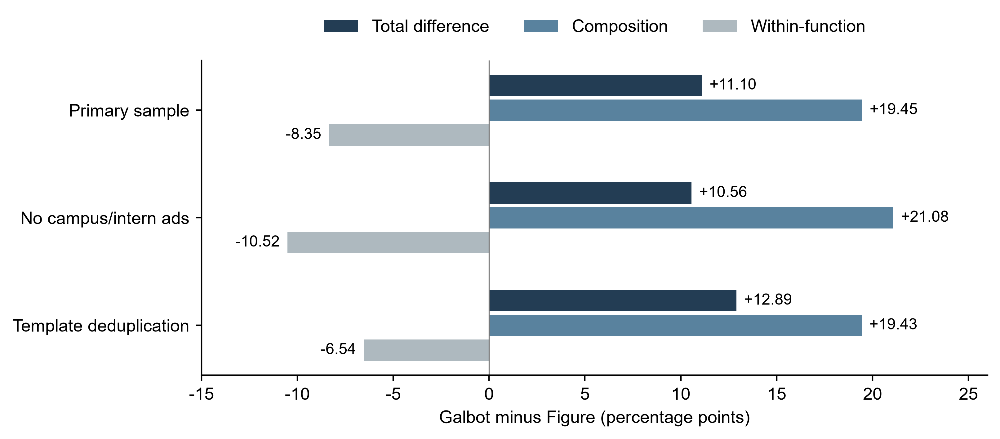

# Supplementary Material

Work Composition and Technology Requirements in Embodied AI Job Advertisements

## S1. Measurement definitions and analytical scopes

This supplement expands the definitions used in Section 2. Supplementary Table S1 maps each analysis to its advertisement scope and unit; Supplementary Table S2 separates technology mention, statement type, and qualification relation. ML, AI and IT denote machine learning, artificial intelligence and information technology, respectively.

Supplementary Table S1. Analysis scopes and observation units

| Analysis | Advertisement scope | Unit and denominator |
| --- | --- | --- |
| Overall work composition | 23 whole firms, 1,630 advertisements | Each advertisement enters one primary function or one structural/unknown category |
| Activities across functions | 1,599 advertisements with evaluable activity status | Activities may overlap; within-function incidence and activity composition use different denominators |
| Specific functions | 1,552 whole-firm advertisements | Unambiguously assigned to 17 specific functions |
| Fixed work-object cases | Two functions in four firms, 84 advertisements | Objects may be multi-valued; these cases do not replace technology-task membership |
| Engineering-activity decomposition | Galbot 82 advertisements; Figure 60 advertisements | Four functions shared by both firms, with at least 10 evaluable advertisements per firm |
| Technology expression | Three primary-function × primary-task intersections, 248 advertisements | ML/AI engineering × robot modeling 105; software and platforms × robot runtime 87; hardware and electrical engineering × board-level circuitry 56; two technologies per group |

Notes: The full corpus contains 1,654 advertisements including the separately reported team; other analyses use the scopes defined here. Technology samples first restrict to whole firms, then intersect the relevant primary function with the primary task; the secondary-task scenario retains the primary-function restriction. The technology crosswalk contains 496 entries, not 496 distinct advertisements. Source: calculations from the job-advertisement corpus.

Supplementary Table S2. Dimensions of technology measurement

| Measure | Recorded content | Counting and interpretation |
| --- | --- | --- |
| M: technology mention | Explicit relevant mention in the focal person’s duties or qualifications | Deduplicated by advertisement; example, choice and relation-unresolved spans may count as mentions |
| W: statement type | DUTY, REQUIRED, GENERAL and PREFERRED | Counted separately among mention advertisements; the four types may overlap |
| G: contextual qualification | Combination of statement type and qualification relation | P, Z and U recorded separately for each combination |
| G displayed in this paper | GENERAL—UNCONDITIONAL | Unconditional item in general qualifications; explicitly REQUIRED items are counted separately |
| U-assignment bounds | Two extreme assignments of recorded unknowns | Point estimate P/N, N=P+Z; bounds P/B to (P+U)/B, B=N+U |

Notes: Mentions, statement types and contexts answer different measurement questions. GENERAL—UNCONDITIONAL is one G cell displayed in this paper; the English Supplement Guide links all 22 qualification-relation cells. Source: calculations from the job-advertisement corpus.

### S1.1 Functions, activities and work objects

Primary function is single-valued when the advertisement has one clear main work area. Composite function records several independent deliverables when no single one dominates; multi-direction recruitment records a posting that explicitly allows recruitment into alternative work directions. Both preserve the relation expressed in the source rather than splitting one advertisement into several observations. Ambiguous, unmapped, and source-insufficient records remain visible. Secondary functions and activities are multivalued, so their totals need not equal the number of advertisements.

Research activity requires both a concrete research problem or object and methodological exploration or scientific testing. Engineering activity requires implementation, integration, debugging, or delivery of an operational system. Quality-related activity includes verification execution, release decisions, compliance, and defect closure across development and production. The activity numerator includes OWNED and explicit shared responsibility, but excludes PARTICIPATES-only relations. Manufacturing or procurement does not become engineering by occupational title, and experience in quality work does not establish that the advertised role performs quality activity. Each activity is summarized in two directions: its incidence within a function, and the function's share of all advertisements recording that activity.

The 84-advertisement object case study permits multiple objects and counts both owned and participated-in relations. It does not define membership in the technology task strata. Those strata instead use the role's main deliverable: policy or embodied-model training and optimization for robot modeling; runtime, middleware, or robot applications for robot runtime software; and boards, printed circuit boards, or related power and drive systems for board-level circuitry. Membership first restricts to the 23 whole-company boards, then intersects the relevant primary function with the main task. Adding a secondary task retains the primary-function restriction and deduplicates by advertisement and target task.

### S1.2 Technology relations and advertisement-level states

A technology can be mentioned in a duty, an explicitly mandatory qualification, a general qualification, or a preferred qualification. Statement type (W) follows headings and local wording. A heading may set the default scope, but a local modifier can override it. Words describing proficiency—such as “strong” or “deep experience”—do not by themselves turn GENERAL into REQUIRED. Choice and example relations propagate through the ancestors of the technology item. A direct or conjunctive item is UNCONDITIONAL only when no governing choice, example, or unresolved restriction applies. Choice and example may coexist. An unresolved ancestor remains UNRESOLVED; the absence of a modifier from a short excerpt does not justify recoding it as unconditional.

States are resolved independently for every advertisement, technology, statement type, and relation cell. An explicit positive yields (P). Without a positive, source exclusion and non-applicability are retained separately; a relevant unresolved relation yields (U); only the remaining evaluable cases yield (Z). Thus (Z) is “no positive recorded for this cell,” not employer absence. A separate, explicit positive in the same advertisement establishes (P) even if another occurrence is an example. Pending work is not converted to (Z) or (U).

The electromagnetic-compatibility, signal-integrity and power-integrity (EMC/SI/PI) indicator is a predefined technology-family measure. It covers explicit electromagnetic compatibility or immunity, signal-integrity or power-integrity analysis and design, and related electromagnetic interference (EMI), electrostatic discharge (ESD), surge, isolation, grounding, shielding or filtering language when used in those contexts. Procurement of compliant components and generic printed-circuit-board design do not qualify. Family members are unioned at the advertisement level, so several members still count once. An 'or' relation between members of the same family can satisfy the family-level union, while the individual members keep their own relations; a choice across families remains a choice. Altium is a named software package and therefore has a different measurement grain; their rates do not estimate a general contrast between software tools and engineering methods.

### S1.3 Weighting, display and sensitivity

Advertisement weighting answers what share of advertisements in the observed sample records a cell. Firm-equal weighting answers the mean of valid firm-specific shares and includes firms with (P=0) whenever (N>0). It reduces the influence of large recruitment boards while the purposive firm sample remains non-representative. Unknown bounds use (B=P+Z+U), so the firms contributing to a bound may differ from those contributing to a point estimate. Valid zero cells remain in the equal-weight mean; (N=0) remains missing.

Template removal groups advertisements within firm and primary function after normalizing whitespace in duties and retains the lexicographically fixed advertisement identifier. For the engineering decomposition, a missing duties field uses the complete description without an 80-character threshold; technology analyses apply the rule only when duties contain at least 80 characters. This procedure tests sensitivity to repeated text and leaves the number of actual openings unmeasured. The campus/internship screen uses explicit title or qualification language after false-positive checks; missing experience requirements do not imply graduate recruitment. The R1–R3 source screens test progressively narrower observability conditions. They impose observability restrictions rather than define probability samples, and a comparison is unavailable when a screen removes one member of the firm pair.

Review depth varies across records. The 469/760/347 split for specific functions means full-text review, boundary review and judgments carried forward from the first round; the task-sample split is 56/164/28. Full-text and boundary review included model-assisted rereading and adjudication of prior records. The process was not independent human double coding, and no intercoder-reliability estimate is reported.

## S2. Firm scope, work objects and coverage

Supplementary Table S3. Sample entities by product and service scope

| Scope category | Entities | Advertisements | Comparison scope |
| --- | --- | --- | --- |
| Complete robots and robotic-system products | 18 | 1245 | Whole firm |
| Tactile components and robot products | 1 | 125 | Whole firm |
| Research team within a large corporation (reported separately) | 1 | 24 | Separate team |
| Cross-embodiment models and software | 3 | 226 | Whole firm |
| In-house robotic fulfillment service | 1 | 34 | Whole firm |

Notes: Categories follow each entity’s product and service scope. The full corpus contains 1,654 advertisements from 24 entities; the whole-firm sample contains 1,630 advertisements from 23 firms, while 24 advertisements from Amazon FAR are reported as a separate team. Entity-level observation dates, recruitment boards and business boundaries appear in the supplementary materials. Source: calculations from the job-advertisement corpus.

Supplementary Table S4. Work objects within ML/AI engineering

| Firm | Models | Data | Product attribution unknown |
| --- | --- | --- | --- |
| AgiBot | 12/12 | 4/12 | 12/12 |
| Galbot | 22/24 | 12/24 | 24/24 |
| Dexterity | 5/5 | 3/5 | 5/5 |
| Nimble Robotics | 3/3 | 3/3 | 3/3 |

Notes: Numerators count advertisements that own or participate in work on the object; denominators are the fixed firm–function cases. Objects may co-occur. The two panels contain 84 advertisements, 81 of which cannot be attributed to a named product. Object coding is distinct from primary-task coding. Source: calculations from the job-advertisement corpus.

Supplementary Table S5. Work objects within software and platforms

| Firm | Robot runtime | Fulfillment IT | Product attribution unknown |
| --- | --- | --- | --- |
| AgiBot | 4/7 | 0/7 | 6/7 |
| Galbot | 19/25 | 0/25 | 25/25 |
| Dexterity | 0/2 | 0/2 | 2/2 |
| Nimble Robotics | 4/6 | 2/6 | 4/6 |

Notes: Numerators count advertisements that own or participate in work on the object; denominators are the fixed firm–function cases. Objects may co-occur. The two panels contain 84 advertisements, 81 of which cannot be attributed to a named product. Object coding is distinct from primary-task coding. Source: calculations from the job-advertisement corpus.

Supplementary Table S6. Firm coverage and small denominators

| Task and technology | Firms with task | M N>0 | M N≥10 | G N>0 | G N≥10 | G valid zero |
| --- | --- | --- | --- | --- | --- | --- |
| Robot modeling — Python | 22 | 22 | 2 | 22 | 2 | 8 |
| Robot modeling — PyTorch | 22 | 22 | 2 | 22 | 2 | 12 |
| Robot runtime software — C++ | 20 | 20 | 2 | 17 | 1 | 6 |
| Robot runtime software — Linux | 20 | 20 | 2 | 20 | 2 | 6 |
| Board-level circuitry — Altium | 18 | 18 | 1 | 18 | 1 | 15 |
| Board-level circuitry — EMC / SI / PI | 18 | 18 | 1 | 18 | 1 | 8 |

Notes: G denotes the GENERAL—UNCONDITIONAL cell. Valid means N>0; ≥10 uses the valid denominator at that measurement layer. Firms with valid denominators and zero positives remain in firm-equal means; N=0 remains missing. company_context_distribution.csv reports point estimates, numerators, denominators and unknown-assignment bounds for all 120 firm-level rows. Source: calculations from the job-advertisement corpus.

## S3. Full sensitivity results and reproducibility

The supplementary package provides the scenarios and contextual evidence underlying the reported comparisons. Supplementary Table S7 reports every engineering-decomposition scenario, including source screens under which the Galbot–Figure comparison is unavailable because Galbot does not pass the screen. Supplementary Table S8 reports all 20 technology-case scenarios with small-sample marks, unresolved counts and assignment bounds.

Supplementary Table S7. All engineering-decomposition scenarios

| Scenario | Galbot coverage | Figure coverage | Total gap pp | Composition pp | Within function pp |
| --- | --- | --- | --- | --- | --- |
| Main scope | 82/181 | 60/126 | +11.10 | +19.45 | -8.35 |
| Exclude campus and internship ads | 63/126 | 60/122 | +10.56 | +21.08 | -10.52 |
| Deduplicate duty templates | 79/177 | 59/118 | +12.89 | +19.43 | -6.54 |
| Source R1 | 0/0 | 60/126 | NA | NA | NA |
| Source R2 | 0/0 | 60/126 | NA | NA | NA |
| Source R3 | 0/0 | 60/126 | NA | NA | NA |

Notes: Galbot minus Figure, within the fixed set of four common functions; pp denotes percentage points. Coverage denominators are advertisements for which activity status could be evaluated in each scenario. NA indicates that the source filter excludes Galbot, so no firm-pair comparison can be formed. The R1, R2 and R3 source screens are defined in Section 2.4 of the article. Source: calculations from the job-advertisement corpus.

Supplementary Table S8. All technology-case sensitivity scenarios

| Firm and technology | Scenario | M positive/N | G positive/N | U | G unknown bounds % |
| --- | --- | --- | --- | --- | --- |
| Galbot — Python | Primary task | 14/18 | 12/16 | 2 | 66.7 to 77.8 |
| Galbot — Python | Include secondary task | 14/18 | 12/16 | 2 | 66.7 to 77.8 |
| Galbot — Python | Deduplicate duty templates | 13/17 | 11/15 | 2 | 64.7 to 76.5 |
| Galbot — Python | Exclude campus and internship ads | 11/13 | 9/11 | 2 | 69.2 to 84.6 |
| X Square Robot — Python | Primary task | 10/21 | 3/14 | 7 | 14.3 to 47.6 |
| X Square Robot — Python | Include secondary task | 10/21 | 3/14 | 7 | 14.3 to 47.6 |
| X Square Robot — Python | Deduplicate duty templates | 9/20 | 3/14 | 6 | 15.0 to 45.0 |
| X Square Robot — Python | Exclude campus and internship ads | 10/21 | 3/14 | 7 | 14.3 to 47.6 |
| Galbot — C++ | Primary task | 14/16 | 9/11 | 5 | 56.2 to 87.5 |
| Galbot — C++ | Include secondary task | 14/16 | 9/11 | 5 | 56.2 to 87.5 |
| Galbot — C++ | Deduplicate duty templates | 14/16 | 9/11 | 5 | 56.2 to 87.5 |
| Galbot — C++ | Exclude campus and internship ads | 11/13 | 8/10 | 3 | 61.5 to 84.6 |
| X Square Robot — C++ | Primary task | 9/10 | 3/4 * | 6 | 30.0 to 90.0 |
| X Square Robot — C++ | Include secondary task | 9/13 | 3/7 * | 6 | 23.1 to 69.2 |
| X Square Robot — C++ | Deduplicate duty templates | 9/10 | 3/4 * | 6 | 30.0 to 90.0 |
| X Square Robot — C++ | Exclude campus and internship ads | 9/10 | 3/4 * | 6 | 30.0 to 90.0 |
| Apptronik Altium | Primary task | 7/12 | 1/12 | 0 | 8.3 to 8.3 |
| Apptronik Altium | Include secondary task | 7/16 | 1/16 | 0 | 6.2 to 6.2 |
| Apptronik Altium | Deduplicate duty templates | 7/10 | 1/10 | 0 | 10.0 to 10.0 |
| Apptronik Altium | Exclude campus and internship ads | 7/12 | 1/12 | 0 | 8.3 to 8.3 |

Notes: G denotes GENERAL—UNCONDITIONAL; * indicates 0<N<10. The Python membership is identical in the main-task and secondary-task scenarios. sensitivity_membership_changes.csv records additions and removals in every scenario. The unknown-assignment bounds do not cover unrecognized coding error. Source: calculations from the job-advertisement corpus.

The contextual evidence archive links 248 task advertisements to 496 advertisement–technology pairs and 456 retained evidence records. Each record preserves a stable advertisement identity, observation version, technology excerpt, its parent sentence or list item, heading position and other relevant evidence from the same advertisement. The three source-text fields used in the analysis are retained. Chinese-language source evidence remains in Chinese. In the article and supplement, quotations translated from Chinese are identified by advertisement ID and as translations, with choice, example and scope language preserved. English-language advertisements remain verbatim.

The reproduction program checks the input manifest and rebuilds the derived analyses, the 15 source-table files and the contextual evidence exports from supplied comma-separated-value (CSV) files and finalized coded records. Its base computation uses Python 3.10 or later and the standard library; optional figure reproduction also requires matplotlib, numpy and an available Chinese font. Reproduction rebuilds links and numerical summaries from those records without repeating semantic coding or assessing coding reliability. The package accompanies the manuscript, and `SUPPLEMENT_GUIDE.md` describes its files and the command for a fresh output directory.

Supplementary Figure S1. Engineering-activity differences and their components

Notes: The figure fixes the four common functions and displays the three comparable scenarios. Supplementary Table S7 reports missing results under the source-filter scenarios. Source: calculations from the job-advertisement corpus.
