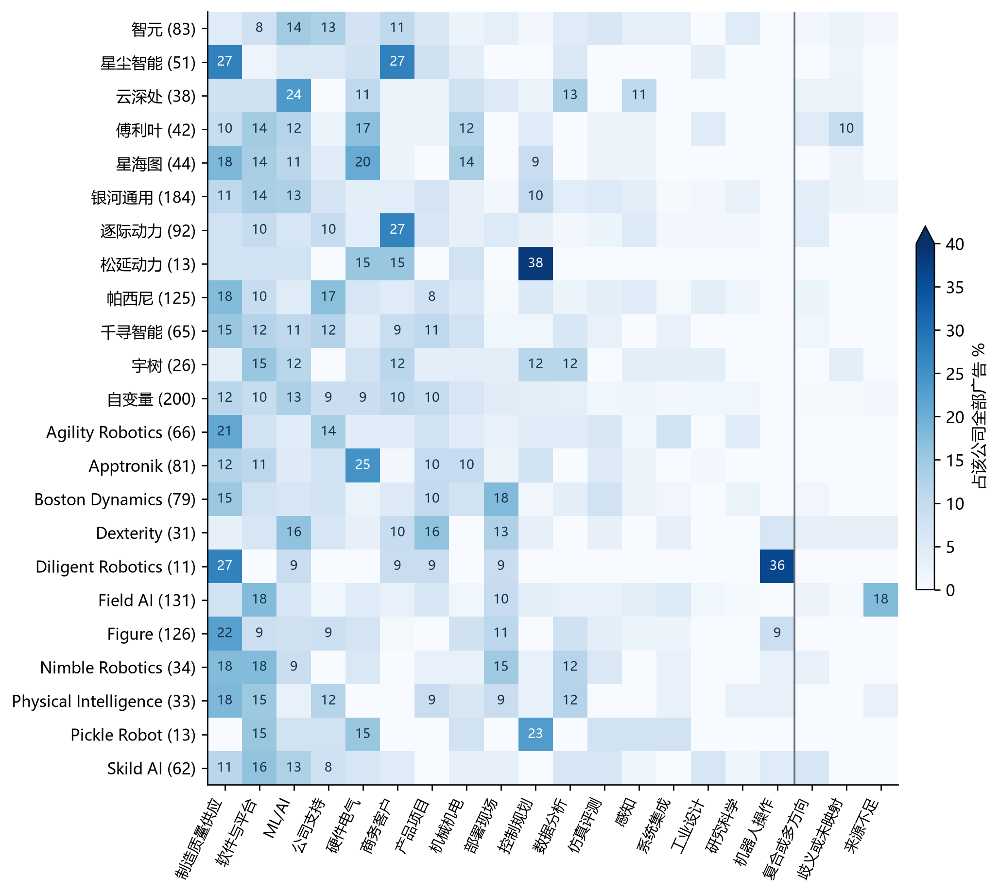
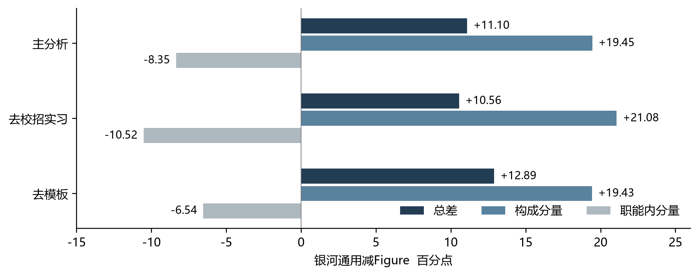
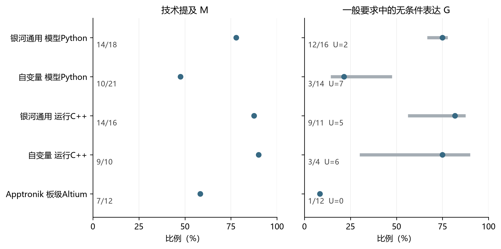

# 具身智能企业公开招聘中的工作组合与技术表达

## 摘要

本文以24个具身智能相关主体的1,654条公开招聘广告为资料，以23家整公司的1,630条广告为主要范围，比较工作构成、任务对象与技术表达。研究与质量活动既在预设对应职能内部较为集中，也广泛分布于其他职能。银河通用与Figure共有的四个职能中，工程活动总差为11.10个百分点，职能构成分量为19.45，职能内分量为−8.35，方向相反。技术分析进一步考察模型、运行软件和板级电路三组岗位中的248条广告，每组选择两项技术。银河通用与自变量在机器人模型岗位中的Python表达差异在既定情景下保留，运行软件C++则在两家公司均频繁出现。PyTorch与Altium未在普通资格要求中被无条件列出的技术提及，多伴随任选或示例写法。电磁兼容等方法在36条广告中被提及，27条写入职责，其中9条仅见于职责。这些结果表明，公司招聘差异分别体现于职能份额、任务对象和技术限定关系。

关键词：具身智能；招聘广告；工作组合；任务对象；技能要求；企业异质性

## 一 引言

判断一家具身智能企业在招什么人，最直观的做法是统计算法、软件和硬件职位，再比较Python、C++或设计工具的出现频率。这类统计便于概览，却容易把不同问题放在一起。企业软件广告较多，可能改变总体技术词频；同为软件职位，开发对象可能是机器人运行系统，也可能是履单业务系统。即使工作对象接近，广告中的工具名称也可能只是一组选项或示例。将这些表达一律理解为候选人必须具备的能力，会改变我们对公司差异的判断。

具身智能招聘尤其适合检视这些区别。模型训练、机器人运行、板卡设计、制造与客户现场工作共同出现在相关企业的招聘板上，某些工作又贯穿多个职能。只统计研究科学岗位，会遗漏其他职能中的研究活动；把一家公司的全部岗位归给旗舰机器人，则会掩盖多产品和支持职能。需要先确定比较的工作范围，再讨论其中的技术表达。

本文关注所观察企业之间的共同点与差异，依次回答三个问题：整体招聘由哪些职能构成，跨职能活动分布在哪里；相同职能中的工作对象有何不同；限定任务后，技术提及与要求结构的区分如何影响公司比较。分析以广告为观察单位，考察企业在公开渠道展示的招聘内容。

既有研究已经区分招聘文本中的工具、对象、替代关系与要求程度，并将这些关系用于经验分析。[12] 本文将这一视角用于具身智能企业，在对应职能与任务范围内连接广告语境、公司分母和未知界限。由此得到几项相互关联的发现：活动在某一职能内部较为集中，同时可以广泛分布于其他职能；公司工程活动总比例的差异，可以与共同职能内分量方向相反；限定任务后，技术表达既呈现保留的公司差异，也呈现共同提及以及任选、示例等写法。逐条连接广告语境，使这些比较具有可核对的文字依据。

本文采用探索性描述设计，沿用前期分析形成的公司案例和六项技术范围。下文先交代资料与测量，再展示工作组合、工程活动分解和技术表达，最后讨论这些结果对招聘比较的含义。

## 二 文献与分析视角

职业类别提供了比较工作的共同尺度，但同一职业中的任务并不相同。Autor与Handel使用劳动者调查，发现职业内部的任务差异与工资差异有关。[1] Deming与Kahn进一步借助专业岗位招聘广告，考察狭义职业内部的企业间技能要求差异。[2] 这些研究已经建立了职业内异质性的经验基础。本文从具身智能招聘出发，关心的是这种异质性具体落在哪些工作对象和表达结构上。

观察层次会影响任务测量的解释。Storm将德国劳动者调查中的任务信息与职业层面的专家任务数据比较，指出个体异质性对任务回报估计的影响。[3] 本文将这一测量问题落实到招聘资料，分别比较公司层面的职能构成、职能内部的活动率和广告级要求表达。三个层次各自提供了理解公司工作组合的信息。

技术提及研究揭示了工作中的多项技能联系。Samek等通过英美人工智能相关招聘广告分析技能共现及专业组合。[4] SkillSpan则以文本片段为单位标注招聘广告中的硬技能与软技能，并公开标注指南。[5] 前者关注技能如何共同出现，后者关注如何识别技能表达。本文进一步考察已识别的技术片段所在的职责、资格或优先条件，以及任选和举例关系怎样限定具体技术。

与本文最直接相关的是Krüger等提出的GOJA。[12] 该研究以实体和关系表示工作过程、工具、工作对象、替代关系与要求程度，并分析机器人作为工具或对象的区别、不同职业中的机器学习活动及PyTorch与TensorFlow的任选关系，其贡献同时涉及语义表示、抽取评估和招聘分析。本文将已有的关系语义视角用于具身企业的比较，连接职能—任务范围、广告级语境状态与公司分母，并结合活动分解和未知界限解释比较结果。

广告中的资格条件还与招聘环境有关。Modestino等利用公司×职位名称组合固定效应及劳动力供给冲击，研究经济衰退期间学历与经验要求的调整。[6] 这提示我们将技术表达放回其发布情境：本文比较两个采集批次中企业公开写出的资格条件，并保留其要求方式与限定关系。

招聘渠道决定了公开资料的观察范围。Fabo与Mýtna Kureková讨论在线劳动市场数据的选择偏误与方法问题；He等使用中国招聘平台资料开展企业招聘研究；Tsvetkova等进一步将Lightcast与官方空缺统计比较，展示国家和统计维度上的覆盖差异。[7][8][9] 本文据此交代主体选择、招聘板范围和观察日期，并并列广告加权与公司等权结果。Acemoglu等依托长期招聘资料及外部信息研究机构层面的人工智能招聘，[10] 提供了将技术表达与企业活动联系起来的经验参照。

本文由此将公司工作构成、任务对象和技术表达连接起来。各层保留相应分母，用来辨认招聘差异发生在职能份额、工作内容还是技术限定关系上。

## 三 数据与方法

### 1 主体范围与样本形成

本研究所称具身智能主体，包括具有公开产品或研发证据的人形与通用机器人、机器人基础模型、机器人学习和操作、移动操作等相关企业，以及为上述工作提供关键部件、软件或部署服务的主体。纳入依据是可识别的业务活动及其与机器人实体工作的联系，不要求每家公司都生产完整机器人。大型集团只有在相关团队与招聘范围能够分开时才进入；缺少明确具身关联的一般人工智能或传统自动化业务，不据其名称纳入。

样本通过公开产品资料、公司信息与招聘源调查形成，兼顾研究相关性、业务方向和来源可获得性，属于有目的的非概率选择。2026年8月31日先采集八家已完成招聘源检查的企业：宇树、千寻智能、自变量、松延动力、Figure、Agility Robotics、Apptronik与Physical Intelligence。各来源在接入前检查岗位详情的可读性、稳定标识和主要字段；随后取得对应招聘板的首轮快照，形成610条参考广告。2026年9月11日再接入16个主体，补充移动操作、多产品机器人、跨本体软件、触觉部件及机器人服务等观察，形成1,044条参考广告。

两轮合计24个主体、1,654条广告。扩展主体的选择同时受公开招聘资料可达性影响；连接失败或正文不可取得的主体，保留接入或资料状态未知。主体接入记录、实际观察日期、招聘板及范围说明随补充材料提供。

主比较范围是23家整公司的1,630条广告；Amazon Frontier AI and Robotics的24条按团队单列。整公司招聘板保留支持与非技术岗位。招聘渠道包括飞书、Moka、Greenhouse、Lever、Workday、Ashby及自建页面，覆盖范围以当时可取得的招聘板为准。8月31日与9月11日分别对应两批广告的实际观察版本。

本文使用锁定的1,654条广告版本，广告身份由公司、来源岗位标识与正文版本共同确定。不同岗位分别保留，来源不足的记录仍进入整体招聘构成，能否参与活动或技术分析则按对应维度确定。资料版本及其来源见补充材料S2。

表1a 分析范围与观察单位

| 分析内容 | 广告范围 | 单位与分母 |
| --- | --- | --- |
| 整体工作构成 | 23家整公司，1,630条 | 每条广告归入一个主职能或结构、未知类别 |
| 跨职能活动 | 其中活动可判1,599条 | 活动可重叠；职能内比例和活动构成使用不同分母 |
| 具体职能 | 整公司1,552条 | 明确归入17类具体职能 |
| 固定对象案例 | 四公司两职能，84条 | 涉及对象可多值；不替代技术分析任务成员 |
| 工程活动分解 | 银河通用82条，Figure 60条 | 两家公司共有且各有至少10条可判广告的四职能 |
| 技术表达 | 三组主职能×主任务交集，248条 | ML/AI工程×模型105、软件与平台×运行87、硬件电气×板级56；每组两项技术 |

注：1,654条为包含团队的全资料范围；其余分析按本表限定。技术样本先限整公司，再取对应主职能与主任务交集；加入次任务仍保留主职能限制。技术对应表含496项，不等于496条不同广告。

### 2 职能 活动与任务对象

主职能依据广告的主要工作归属，明确时单选17类之一。全资料中1,576条属于具体职能，整公司范围为1,552条。整公司其余78条包括19条复合职能、11条多方向招聘、15条歧义、2条未映射和31条来源不足。整体构成使用1,630条作分母，并保留这些结构与未知类别。次职能和活动允许多值，不能与主职能直接相加。

研究探索、工程和宽质量活动依据职责内容记录。研究探索须有具体研究问题或对象，并涉及方法探索或科学检验；仅有复现、调参、性能优化或创新口号不自动计入。工程活动指工程实现、集成、调试与可运行系统交付。制造、装配或采购供应执行不因属于工程岗位就自动计为工程活动；验证执行、质量放行、合规和缺陷闭环另计宽质量，不限于制造质量。三个活动允许同时为正例，各须有相应职责依据。

活动汇总只计本人直接承担的OWNED记录，明确共同负责也可计入；仅参与或协助的PARTICIPATES记录不进入这一分子。智元N0440将“优化具身算法模型结构，以支持具身算法的实现和高效运行”列为职责，据此记录本人承担工程活动；这类优化表述本身不足以自动判为研究探索。研究科学和制造质量供应链分别作为研究、宽质量的预设对应主职能。每项活动同时计算职能内发生率，以及该职能在全部活动广告中的占比，分别描述职能内部的集中程度和活动分布。整公司活动可判范围为1,599条，排除31条来源不足记录。规则与案例见补充材料S1。

对象分析使用智元、银河通用、Dexterity和Nimble的ML及软件职能案例，共84条。模型、数据、机器人运行与履单IT等对象按广告是否涉及记录，允许承担或参与。技术分析另按职责主要交付划分三类任务：机器人模型侧重策略或具身模型的训练优化；运行软件侧重机器人运行时、中间件与应用；板级电路侧重板卡、PCB及相关电源驱动。筛选先限23家整公司，再取对应主职能与主任务的交集：ML/AI工程与机器人模型105条，软件与平台与机器人运行软件87条，硬件与电气与板级电路56条。三组互不重叠，任务归属由职责对象确定。

### 3 技术提及与要求语境

技术测量从提及、表达位置和语境组合三个层次展开（表1b）。M按广告记录技术提及，W记录同一提及所在的表达位置，G将要求方式与限定关系结合。示例、任选及关系未解的片段仍可构成明确提及；M的分母依据本层状态确定。

表1b 技术表达的测量层次

| 测量 | 记录内容 | 计数与解释 |
| --- | --- | --- |
| M 技术提及 | 本人职责或资格条件中的明确相关提及 | 按广告去重；示例、任选与关系未解片段可形成提及 |
| W 表达位置 | 职责、明确必备、一般要求、优先条件 | 在提及广告中分别计数，四类允许重叠 |
| G 具体语境 | 要求方式与限定关系的组合 | 每个组合分别记录P、Z、U |
| 本文展示的G | GENERAL—UNCONDITIONAL | 普通资格要求中的无条件项；明确必备另计 |
| U赋值界限 | 对已识别未知作两种极端赋值 | 点值P/N，N=P+Z；界限P/B至(P+U)/B，B=N+U |

注：提及、位置与语境回答不同测量问题。一般无条件是本文展示的一个G格；全部22格见补充材料S4。

下文重点展示G中的“一般要求—无条件”，简称一般无条件格。GENERAL对应普通资格要求，REQUIRED对应明确必备，两者分别计数。只在Required条件中出现的技术归入必备格。M、W、G描述不同测量维度，而非要求强度逐级提高的三个等级。

要求方式根据标题和具体措辞判断。普通任职要求中的熟悉、经验或能力要求归GENERAL；明确“必须”“必备”或Required的要求归REQUIRED；“优先”“加分”或Preferred归PREFERRED。章节标题形成作用域内的默认方式，具体项目旁的局部修饰可覆盖默认；“Strong”“精通”“Deep experience”描述熟练程度，本身不决定是否为明确必备。Dexterity的N0874把“Strong Python programming skills”置于Required Skills下，故记为REQUIRED；Agility的E0329将Altium经验列于About You及其资格说明下，记为GENERAL。

分支沿技术项及其全部祖先关系判断：没有任选、示例或未解限定的直接项与合取项可记UNCONDITIONAL；“或”“至少一种”作用到相应选项，“如”“等”作用到相应示例范围，两者可并存。未解关系保留UNRESOLVED，不能因短片段没有修饰词就判为无条件。同一广告若有另一处符合该格的明确表达，即可形成该格正例；一个示例片段不会抵消它。只有缺少该格明确正例且存在影响本格的未解记录时，才可能记U，来源排除和不适用另按记录处理。完整判据、优先顺序和案例见补充材料S1。

每个语境格独立记录P、Z、U。P为已有明确正例，Z为当前未记录该格正例，U为存在影响该格判断的未解对象、责任或关系；不适用与来源排除另列。有效分母N为P+Z，点值为P/N。令B=N+U，则已识别未知的赋值界限为P/B至(P+U)/B。N为零时不计算点值。该界限反映已记录未知可能带来的范围，不是抽样置信区间，也不包含尚未发现的漏判。

EMC/SI/PI是家族指标，覆盖明确的电磁兼容、抗扰、信号或电源完整性分析与设计，以及处于这些语境中的EMI、ESD、浪涌、隔离、接地、屏蔽与滤波等表达。仅有采购合规器件或一般PCB设计不计入。家族内任一成员满足相应语境即可计入，同一广告多个成员取并集后只计一次。家族内部的“或”仍可满足这一并集定义，具体成员保留各自的限定关系；跨家族选择按任选处理。因此，EMC/SI/PI对应一组方法，Altium对应单一软件，二者采用不同的测量粒度。

本文将六项技术的496个广告—技术项逐条连接，并保留456条相关证据。在每项技术的M正例中，先区分一般无条件P、Z和U，再列出未进入P的记录所含表达：仅优先、仅职责、明确必备、任选、示例、条件或未解分支。语境状态互斥，表达标志允许重叠，用于呈现同一广告的多种写法。

### 4 比较规则与敏感性情景

广告加权比例先合并各公司正例与有效分母，再相除；公司等权比例对所有N大于零公司的P/N取均值，包括正例为零的公司。未知界限使用B大于零的集合，可能与点值的公司集合不同。组汇总的展示条件为至少三家公司、合计有效分母不低于20；公司0<N<10标为小样本。正文选中案例之外，补充材料列出六项技术全部120行公司结果，不删除零值或无有效分母的记录。

工程活动采用Kitagawa式对称分解，将固定共同职能内的总率差分为职能构成与职能内活动率两个分量。[11] 以银河通用为A、Figure为B，w表示各职能在共同范围中的份额，r表示职能内活动率；构成分量为各职能“份额差×两公司活动率均值”之和，职能内分量为“活动率差×两公司份额均值”之和。两者相加恰好等于总差，属于算术恒等式，不表示因果贡献。

共同职能由主分析中两家公司各至少10条活动可判广告确定，并要求至少两个共同职能。该规则在这对公司中得到公司支持、制造质量供应链、ML和软件四类。敏感性分析固定这四类；出现零观察时记为不可比，低于10但非零时保留诊断标记，不重新挑选能够维持原结论的职能。

来源筛选设R1、R2、R3三个方案。R1只保留全部广告的活动维度均可判的公司；R2进一步要求官方招聘源、来源质量为GOOD或EXCELLENT，且主职能也无来源不足；R3在R2内仅保留完整描述不少于200字符的广告。质量等级来自接入检查：GOOD指公开结构化或较规则、标识稳定且正文较完整，EXCELLENT还具备更完整的结构化字段与重复采集条件。R1保留17家公司968条广告，R2为11家576条，R3为11家557条。

去模板按各分析原有范围实施。工程分解在同公司、同主职能内，将职责文本归一空白后完全相同的广告归组；职责为空时使用完整描述，不设80字符门槛。技术比较只对不少于80字符的职责文本应用相同归组。两者都按广告身份的字典序保留一条固定代表，不判断实际招聘空缺是否重复。去校招实习则依据标题或资格中的明确实习、校招、应届等表达，经过误命中核对；未写年限不等于应届。加入次任务时仍保留对应主职能限制，在主任务或次任务包含目标任务的记录中，按广告与目标任务去重。

具体职能资料中，469条经过全文复核，760条经过边界复核，347条继承首轮判读；三类主任务中对应为56、164、28条。各轮编码、最终版本和研究者确认的范围见补充材料S2。本文使用这些既有语义记录开展描述比较。

## 四 公司工作组合与跨职能活动

### 1 招聘构成及其观察范围

23家整公司中，18家以整机与机器人系统产品为主要供给范围，3家以跨本体模型与软件为主，另有自营机器人履单服务以及触觉部件与机器人产品组合各1家。各类主体的数量与广告规模见表2a。

表2a 样本主体与供给范围

| 范围类别 | 主体数 | 广告数 | 比较范围 |
| --- | --- | --- | --- |
| 整机与机器人系统产品 | 18 | 1245 | 整公司 |
| 触觉部件与机器人产品组合 | 1 | 125 | 整公司 |
| 大公司内部研究团队（范围单列） | 1 | 24 | 单列团队 |
| 跨本体模型与软件 | 3 | 226 | 整公司 |
| 自营机器人履单服务 | 1 | 34 | 整公司 |

注：类别依据主体的产品与服务范围划分。全部24主体1,654条，其中23家整公司1,630条；Amazon FAR的24条按团队单列。逐主体观察日期、招聘板和业务边界见补充材料。

制造质量供应链、软件与平台、ML/AI工程、公司支持、硬件与电气分别有214、180、156、132、123条广告，占整公司广告的13.1%、11.0%、9.6%、8.1%和7.5%。这些较大的类别同时涉及算法、系统开发、实体生产和组织支持。公司等权后，制造、软件与ML仍较突出，但公司支持和硬件的相对次序改变，说明合并比例受到招聘板规模影响。

表2b 整公司职能构成

| 主职能 | 广告数 | 广告加权 % | 公司等权 % |
| --- | --- | --- | --- |
| 制造、质量与供应链 | 214 | 13.1 | 13.0 |
| 软件与平台 | 180 | 11.0 | 10.8 |
| ML/AI工程 | 156 | 9.6 | 9.7 |
| 公司支持 | 132 | 8.1 | 6.7 |
| 硬件与电气 | 123 | 7.5 | 8.2 |
| 商务与客户 | 117 | 7.2 | 7.3 |
| 产品与项目 | 106 | 6.5 | 5.9 |
| 机械与机电 | 89 | 5.5 | 5.6 |
| 部署与现场服务 | 84 | 5.2 | 5.2 |
| 控制与规划 | 75 | 4.6 | 6.2 |
| 数据与分析 | 70 | 4.3 | 4.5 |
| 仿真、评测与测量工具链 | 60 | 3.7 | 3.3 |
| 感知 | 47 | 2.9 | 2.6 |
| 系统工程与跨域集成 | 31 | 1.9 | 2.1 |
| 工业与体验设计 | 23 | 1.4 | 1.3 |
| 研究科学 | 23 | 1.4 | 1.1 |
| 机器人操作 | 22 | 1.3 | 2.7 |
| 复合及多方向 | 30 | 1.8 | 1.6 |
| 歧义 未映射 来源不足 | 48 | 2.9 | 2.5 |

注：广告加权以全部1,630条整公司广告为分母，包括1,552条具体职能广告及78条结构或未明记录。公司等权为各公司内部比例的平均值。

不同公司的构成有明显差别。银河通用的软件与ML分别为25/184和24/184，Figure的制造质量供应链为28/126、软件为11/126；Apptronik的硬件与电气为20/81，Nimble的软件与制造质量供应链各为6/34。图1同时保留复合、多方向以及未明类别，避免把缺失记录从各公司分母中删去。

图1 公司招聘的职能构成与未明记录

注：括号内为公司广告数，分母保留全部广告；右侧三列分别为结构类、歧义或未映射、来源不足，整行合计100%。色阶40%以上封顶，格内标注8%以上的比例。

Field AI的131条广告中，23条主职能来源不足，与软件广告数量相同。图1将这些记录单列，并在公司分母中保留全部131条广告，使可识别职能与资料缺失的份额同时可见。

### 2 活动分散与职能集中可以同时存在

研究探索活动共有66条，其中48条不属于研究科学主职能，占72.7%。但在研究科学职能内部，18/23条涉及研究探索，比例为78.3%；ML职能中36/156条涉及研究，占23.1%，却贡献了全部研究活动的54.5%。研究科学内部更加集中，ML因广告基数较大而承载更多研究活动，两种结果描述的是不同方向的分布。

表3a 活动的职能内发生率与职能分布

| 活动 | 主职能 | 活动数/职能数 | 职能内 % | 活动数/活动总数 | 活动构成 % |
| --- | --- | --- | --- | --- | --- |
| 研究探索 | 研究科学 | 18/23 | 78.3 | 18/66 | 27.3 |
| 研究探索 | ML/AI工程 | 36/156 | 23.1 | 36/66 | 54.5 |
| 研究探索 | 感知 | 5/47 | 10.6 | 5/66 | 7.6 |
| 宽质量 | 制造质量供应链 | 159/214 | 74.3 | 159/459 | 34.6 |
| 宽质量 | 硬件与电气 | 53/123 | 43.1 | 53/459 | 11.5 |
| 宽质量 | 机械与机电 | 36/89 | 40.4 | 36/459 | 7.8 |
| 宽质量 | 部署与现场服务 | 34/84 | 40.5 | 34/459 | 7.4 |
| 宽质量 | 系统工程与集成 | 21/31 | 67.7 | 21/459 | 4.6 |

注：职能数限活动可判的广告。研究探索共有66条，宽质量459条。正文列主要分布职能，完整各类（含零值、结构类与未知）见activity_bidirectional.csv。研究科学和制造质量供应链分别为预设对应职能，并非按结果选择。

宽质量也呈现类似关系。制造质量供应链内159/214条涉及宽质量，占74.3%，但只占全部459条质量活动的34.6%。硬件、机械、部署现场和系统集成也有相当数量的质量活动，其中系统集成为21/31，硬件为53/123。质量相关工作因而不仅出现在制造岗位中，也写入设计、集成和交付职责。

459条质量活动中，296条能够确定在预设对应职能之外，另有4条主职能歧义；将后者分别归入对应职能内外，外部比例为64.5%至65.4%。研究与质量的双向统计共同说明：主要职能概括了岗位归属，活动记录则展示了相关工作如何跨越职能边界。

### 3 相同职能中的工作对象

所选案例中，智元与银河通用的ML广告涉及模型对象分别为12/12、22/24，涉及数据分别为4/12、12/24。软件职能中，银河通用19/25条涉及机器人运行；Nimble对应为4/6，同时有2/6涉及履单IT。部分广告同时涉及多个对象。

表3b ML/AI工程职能的对象

| 公司 | 模型 | 数据 | 产品归属未知 |
| --- | --- | --- | --- |
| 智元 | 12/12 | 4/12 | 12/12 |
| 银河通用 | 22/24 | 12/24 | 24/24 |
| Dexterity | 5/5 | 3/5 | 5/5 |
| Nimble Robotics | 3/3 | 3/3 | 3/3 |

注：分子为承担或参与该对象的广告数，分母为该公司该职能的固定案例数。对象可共现。两表共84条，其中81条无法归属命名产品；对象分类不等于主任务分类。

表3c 软件职能的对象

| 公司 | 机器人运行 | 履单IT | 产品归属未知 |
| --- | --- | --- | --- |
| 智元 | 4/7 | 0/7 | 6/7 |
| 银河通用 | 19/25 | 0/25 | 25/25 |
| Dexterity | 0/2 | 0/2 | 2/2 |
| Nimble Robotics | 4/6 | 2/6 | 4/6 |

注：分子为承担或参与该对象的广告数，分母为该公司该职能的固定案例数。对象可共现。两表共84条，其中81条无法归属命名产品；对象分类不等于主任务分类。

同一职能内的开发对象存在差别，后续技术比较因此进一步限定机器人模型、运行软件和板级电路任务。84条对象案例中，3条能连接到具体命名产品，其余81条保留产品归属未知。相较于产品名称，广告对工作对象的描述更充分，为任务比较提供了依据。

## 五 职能构成与工程活动差异

在两家公司共有的四个职能范围内，银河通用的合并工程活动率高于Figure，但构成分量与职能内分量方向相反。表4a列出主分析和敏感性情景的结果，表4b提供各职能的基础计数。

表4a 工程活动差异的分解

| 情景 | 银河覆盖 | Figure覆盖 | 总差 pp | 构成 pp | 职能内 pp |
| --- | --- | --- | --- | --- | --- |
| 主范围 | 82/181 | 60/126 | +11.10 | +19.45 | -8.35 |
| 去校招实习 | 63/126 | 60/122 | +10.56 | +21.08 | -10.52 |
| 去模板 | 79/177 | 59/118 | +12.89 | +19.43 | -6.54 |

注：银河通用减Figure，固定四共同职能。覆盖分母为对应情景活动可判的广告数。完整情景及缺失结果见附表A1。pp为百分点。

表4b 主分析的四职能基础与分量

| 职能 | 银河 活动/广告 | Figure 活动/广告 | 银河/ Figure份额 % | 构成 pp | 职能内 pp |
| --- | --- | --- | --- | --- | --- |
| 公司支持 | 0/13 | 1/11 | 15.9 / 18.3 | -0.11 | -1.55 |
| 制造质量供应链 | 3/20 | 5/28 | 24.4 / 46.7 | -3.66 | -1.02 |
| ML/AI工程 | 20/24 | 10/10 | 29.3 / 16.7 | +11.55 | -3.83 |
| 软件与平台 | 23/25 | 11/11 | 30.5 / 18.3 | +11.67 | -1.95 |

注：两公司共同范围的分母分别为82、60；活动数/广告数可直接还原各职能内工程活动率。两类分量分别加总为+19.45和−8.35个百分点。

在共同职能范围内，银河通用的ML与软件广告共49/82条，占59.8%；Figure为21/60条，占35.0%。银河通用在这两个工程活动率较高的职能中占比更大，形成正向构成分量；Figure在各共同职能内的工程活动率更高，形成反向的职能内分量。图2显示，正向构成分量抵消负向职能内分量后，银河通用仍呈现较高的合并比例。

图2 工程活动的总体差异与两个分量

注：固定四共同职能，图示三个可比情景；来源方案的缺失结果见附表A1。

去校招实习和职责模板去重后，两项分量仍保持相反方向，合并比例的方向也与主分析一致。

主分析覆盖银河通用82/181、Figure60/126条活动可判广告，比较范围为这四个共同职能。R1、R2、R3均排除了银河通用，无法形成公司对比较；全部情景见附表A1。

## 六 相近任务中的技术表达

### 1 技术出现在哪里

机器人模型任务中的Python、PyTorch提及分别为73/105、83/105；运行软件中的C++、Linux为80/87、52/87；板级电路中的Altium与电磁兼容、信号及电源完整性为24/56、36/56。前两类任务以编程语言、框架和运行系统为主要观察项，板级任务同时涉及设计工具与工程验证方法。

表5a 技术提及与表达位置

| 任务与技术 | M 正例/分母 | 广告 % | 等权 % | 职责 | 必备 | 一般 | 优先 |
| --- | --- | --- | --- | --- | --- | --- | --- |
| 机器人模型 Python | 73/105 | 69.5 | 66.9 | 3 | 2 | 65 | 6 |
| 机器人模型 PyTorch | 83/105 | 79.0 | 74.5 | 1 | 4 | 75 | 4 |
| 运行软件 C++ | 80/87 | 92.0 | 91.4 | 13 | 1 | 73 | 6 |
| 运行软件 Linux | 52/87 | 59.8 | 50.2 | 9 | 0 | 50 | 6 |
| 板级电路 Altium | 24/56 | 42.9 | 35.2 | 5 | 0 | 21 | 5 |
| 板级电路 EMC / SI / PI | 36/56 | 64.3 | 67.8 | 27 | 0 | 20 | 11 |

注：后四列为提及广告中的表达方式计数，各自可除以本行M正例数；允许重叠。职责按广告合并本人使用与开发。等权均值包括有效分母大于零且正例为零的公司。EMC/SI/PI为兼容性、完整性与相关防护的家族指标，成员按广告取并集去重，与单一Altium工具的粒度不同；成员与分支规则见补充材料S1。

各项技术的表达位置有所不同。Python的73条提及中，65条出现于一般要求，6条于优先条件，2条于明确必备，3条于职责；C++的相应计数为73、6、1、13。电磁兼容、信号及电源完整性相关方法的36条提及中，27条出现在职责部分，其中9条仅出现在职责部分；Altium的24条提及中有5条写入职责。该方法家族既通过资格条件表达，也直接写入岗位的工作内容。

表5b 一般要求中的无条件表达

| 任务与指标 | 一般无条件 正例/分母 | U | G 广告 % | G 等权 % | 未知界限 % |
| --- | --- | --- | --- | --- | --- |
| 机器人模型 Python | 40/88 | 17 | 45.5 | 41.7 | 38.1 至 54.3 |
| 机器人模型 PyTorch | 20/97 | 8 | 20.6 | 20.4 | 19.0 至 26.7 |
| 运行软件 C++ | 38/64 | 23 | 59.4 | 51.5 | 43.7 至 70.1 |
| 运行软件 Linux | 47/86 | 1 | 54.7 | 46.0 | 54.0 至 55.2 |
| 板级电路 Altium | 5/56 | 0 | 8.9 | 8.8 | 8.9 至 8.9 |
| 板级电路 EMC / SI / PI | 15/56 | 0 | 26.8 | 28.2 | 26.8 至 26.8 |

注：G此处仅展示GENERAL—UNCONDITIONAL，不合并明确必备。点值为P/N，N=P+Z；未知界限为P/B至(P+U)/B，B=N+U，不是置信区间。全部22格（含其余21格）的公司与汇总CSV见appendix/补充材料索引.md的S4。

### 2 提及广告中的具体语境

表5c以提及广告为范围，考察其中有多少同时具有一般无条件表达。PyTorch的83条提及中，20条符合这一语境，55条未记录到相应表达，8条未知；后两类共63条，其中52条包含任选或示例。Altium的24条提及中，5条具有一般无条件表达，其余19条中有17条含任选或示例。因此，没有记录到一般无条件表达的PyTorch与Altium提及，常伴随列举技术范围的写法。

表5c 提及广告与一般无条件状态的逐条对应

| 任务与技术 | 提及数 | 一般无条件 P | P/提及数 % | 未记该格 Z | 该格未知 U | 其余记录含任选/示例 |
| --- | --- | --- | --- | --- | --- | --- |
| 机器人模型 Python | 73 | 40 | 54.8 | 16 | 17 | 11/33 |
| 机器人模型 PyTorch | 83 | 20 | 24.1 | 55 | 8 | 52/63 |
| 运行软件 C++ | 80 | 38 | 47.5 | 19 | 23 | 16/42 |
| 运行软件 Linux | 52 | 47 | 90.4 | 4 | 1 | 2/5 |
| 板级电路 Altium | 24 | 5 | 20.8 | 19 | 0 | 17/19 |
| 板级电路 EMC / SI / PI | 36 | 15 | 41.7 | 21 | 0 | 6/21 |

注：P、Z、U在提及广告中互斥且相加等于提及数。P/提及数以本行全部提及广告为分母，保留U；表5b的点值分母为该任务中此语境的P+Z。最后一列的分母为Z+U，分子为其中至少有一条任选、示例或两者并存表达的广告；可与优先、职责、必备及未解分支重叠，不能用作互斥原因分解。

Linux提及中已有一般无条件表达的比例为90.4%，PyTorch与Altium分别为24.1%和20.8%。这些比例以各自的提及广告为分母，其中包括该语境仍未知的记录；表5b则以相应任务中这一语境可判的广告为分母。两表分别回答技术在提及范围内怎样表达，以及这种表达在任务广告中有多普遍。

原文例子进一步说明这些区分。帕西尼一条板级广告在“任职资格—技能要求”下写道：“熟悉至少一种EDA工具（如Altium Designer、PADS等）进行原理图绘制和PCB布局设计”（N0339）。该句要求候选人至少熟悉一种EDA工具，并以Altium Designer和PADS列举工具范围。另一条Agility Robotics广告写“Deep experience with Altium for component generation and schematic entry”（E0329），直接将Altium经验列为一般资格；其后Bonus Points中带有任选或优先限定的Altium经验，与前面的GENERAL—UNCONDITIONAL正例同时保留。

示例与任选具有不同含义。智元N0440写“熟悉PyTorch、JAX、TensorFlow等深度学习框架”，最终记录将“等”判为示例，未赋予任选关系；傅利叶N0460的“熟悉 PyTorch 等主流深度学习框架”同样保留示例范围。两句都列举了框架名称，帕西尼广告中的“至少一种”则明确给出了选择关系。

宇树广告中的“负责EMC/EMI电磁兼容的设计与测试”（E0099）写在职责部分，对应工作内容；Required或Preferred下的技术则分别进入明确必备或优先表达。广告的具体措辞和段落位置，共同决定其要求语境。

上述广告的完整句子、标题、最终理由及同广告其他相关片段，见补充材料S3。

### 3 公司分布与案例比较

六项技术的完整公司结果覆盖模型任务22家、运行软件20家、板级电路18家，共120个公司—技术点。大多数公司在单一任务中的广告较少。Python与PyTorch各只有两家公司的提及分母达到10；板级两项技术各只有一家达到10。运行软件C++的一般无条件格，有效分母大于零的公司为17家，其中仅一家达到10。表5d因此将覆盖和小样本情况与案例一起呈现，完整点值及未知界限列于补充材料。

表5d 六项技术的公司覆盖与小样本情况

| 任务与技术 | 有任务公司 | M 有效 | M ≥10 | G 有效 | G ≥10 | G 有效零值 |
| --- | --- | --- | --- | --- | --- | --- |
| 机器人模型 Python | 22 | 22 | 2 | 22 | 2 | 8 |
| 机器人模型 PyTorch | 22 | 22 | 2 | 22 | 2 | 12 |
| 运行软件 C++ | 20 | 20 | 2 | 17 | 1 | 6 |
| 运行软件 Linux | 20 | 20 | 2 | 20 | 2 | 6 |
| 板级电路 Altium | 18 | 18 | 1 | 18 | 1 | 15 |
| 板级电路 EMC / SI / PI | 18 | 18 | 1 | 18 | 1 | 8 |

注：G指一般无条件格；有效指N>0，≥10按该层有效分母计算。零值公司仍进入等权均值，N=0留作缺失。完整120行公司点值、分子、分母和未知界限见company_context_distribution.csv。

银河通用在模型岗位中的Python提及为14/18，自变量为10/21；一般无条件表达分别为12/16、U=2，以及3/14、U=7。将已识别未知分别赋为非正例和正例，界限为66.7%至77.8%与14.3%至47.6%，不重叠。去模板和去校招实习后，这一方向仍保留；加入次任务时，两公司的成员与主任务情景相同。各情景完整结果见附表A2。

图3 固定案例的技术提及与一般无条件表达

注：左右两图的点分别为M、G的P/N，N=P+Z；文字列P/N，G另列未知数U。灰线以B=N+U为分母，从P/B至(P+U)/B，表示已识别未知的赋值界限，不是置信区间。

运行软件C++的提及为银河通用14/16、自变量9/10，两者都较常见。一般无条件表达分别为9/11、U=5和3/4、U=6，未知界限重叠；自变量的有效分母仅4条。这里最明确的共同点是两家公司都频繁提到C++。加入次任务后，自变量增加3条广告；去模板后，两家公司的主任务成员均未改变。

Apptronik的12条板级广告中，7条提及Altium，1条具有一般无条件表达；其余6条中，1条仅为示例，5条同时包含任选与示例。这个案例呈现了品牌提及与无条件单独指定之间的差别。

## 七 讨论

识别企业招聘中的研究活动时，岗位主职能与活动记录提供不同信息。研究科学岗位中的研究活动较集中，数量更大的ML岗位则承载了更多研究广告。仅按主职能选取广告会缩小所观察的活动范围；同时报告职能内发生率和活动分布，能够说明一项工作在哪类岗位中集中，又由哪些岗位承载。质量活动的跨职能分布也适用这一观察方法。

比较公司总体活动率时，职能份额决定了各类岗位在合并结果中的权重。银河通用与Figure的例子显示，总体招聘组合和共同职能内部可以给出不同方向的比较。因此，解释一个公司间比例差异时，需要同时查看纳入的岗位组合与各职能内的活动率，区分差异来自工作构成的哪一部分。

技术名称说明它是否进入招聘范围，父句和段落则说明它被写成工作内容、明确条件还是列举范围。表5b描述一般无条件表达在任务广告中的普遍程度，表5c描述这一表达在已提及技术的广告中占多少。Linux与PyTorch、Altium在后一个比例上的差别，使语境区分的用途更清楚：相似的提及统计可能包含不同的资格写法。电磁兼容等方法则通过岗位职责和资格条件得到表达。

GOJA已将工作对象、工具及其关系用于招聘分析。[12] 本文将这一视角落实到同一企业样本中的多层比较，连接工作分布与技术限定关系。银河通用与自变量在模型岗位中的Python表达保留差异，运行软件中的C++则呈现共同提及。两种结果说明，具体任务范围和广告语境有助于辨认公司之间在哪些方面不同、在哪些方面相近。

本研究采用两个采集批次形成的目的性样本，结论限于所观察企业的公开招聘文本，与人员配置和实际录用有别。对象案例、共同职能分解和技术分析各有特定范围，多数公司—任务单元较小；任务内部内容、资历结构与招聘模板也可能关联所观察的公司差异。编码复核深度不同，文中赋值界限仅处理已识别的未解状态。实际录用行为、样本外推广和测量准确率，分别需要招聘过程资料、可比新样本和独立验证。

## 八 结论

本文在同一批具身智能招聘资料中连接了公司职能构成、岗位工作对象和技术要求表达。研究与质量活动呈现职能内集中和跨职能分布并存的特征；银河通用与Figure的工程活动比较显示，构成分量与职能内分量方向相反。限定任务后，银河通用与自变量在模型岗位中的Python表达仍有差异，运行软件C++在两家公司均频繁出现；Apptronik板级广告中的Altium则更多出现在任选或示例范围。

这些结果将公司招聘差异具体化为工作构成、任务内容和技术限定关系。先明确工作范围，再区分提及位置和逻辑关系，可以说明企业公开招聘中的共同技术表达与局部差异分别体现在哪里。

## 参考文献

[1] Autor, D. H., & Handel, M. J. (2013). Putting Tasks to the Test: Human Capital, Job Tasks, and Wages. Journal of Labor Economics, 31(S1), S59–S96. https://doi.org/10.1086/669332

[2] Deming, D., & Kahn, L. B. (2017). Skill Requirements across Firms and Labor Markets: Evidence from Job Postings for Professionals. NBER Working Paper No. 23328, revised May 2017. https://doi.org/10.3386/w23328

[3] Storm, E. (2023). On the measurement of tasks: does expert data get it right? Journal for Labour Market Research, 57, 6. https://doi.org/10.1186/s12651-023-00332-z

[4] Samek, L., Squicciarini, M., & Cammeraat, E. (2021). The human capital behind AI: Jobs and skills demand from online job postings. OECD Science, Technology and Industry Policy Papers, No. 120. https://doi.org/10.1787/2e278150-en

[5] Zhang, M., Jensen, K., Sonniks, S., & Plank, B. (2022). SkillSpan: Hard and Soft Skill Extraction from English Job Postings. Proceedings of NAACL-HLT 2022, 4962–4984. https://doi.org/10.18653/v1/2022.naacl-main.366

[6] Modestino, A. S., Shoag, D., & Ballance, J. (2019). Upskilling: Do Employers Demand Greater Skill When Workers Are Plentiful? Author preprint. https://aliciasassermodestino.com/wp-content/uploads/2019/04/2019-RESTAT-Upskilling-Preprint-1.pdf

[7] Fabo, B., & Mýtna Kureková, L. (2022). Methodological issues related to the use of online labour market data. ILO Working Paper No. 68. https://doi.org/10.54394/ZZBC8484

[8] He, C., Mau, K., & Xu, M. (2021). Trade Shocks and Firms' Hiring Decisions: Evidence from Vacancy Postings of Chinese Firms in the Trade War. GSBE Research Memorandum 2021/001. https://cris.maastrichtuniversity.nl/ws/files/61116950/RM21001.pdf

[9] Tsvetkova, A., D'Amico, E., Lembcke, A., Knutsson, P., & Vermeulen, W. (2024). How well do online job postings match national sources in large English speaking countries? Benchmarking Lightcast data against statistical sources across regions, sectors and occupations. OECD Local Economic and Employment Development Papers, 2024/01. https://doi.org/10.1787/c17cae09-en

[10] Acemoglu, D., Autor, D., Hazell, J., & Restrepo, P. (2022). AI and Jobs: Evidence from Online Vacancies. NBER Working Paper No. 28257, revised February 2022. https://doi.org/10.3386/w28257

[11] Kitagawa, E. M. (1955). Components of a Difference Between Two Rates. Journal of the American Statistical Association, 50(272), 1168–1194. https://doi.org/10.1080/01621459.1955.10501299

[12] Krüger, K., Binnewitt, J., Ehmann, K., Winnige, S., & Akbik, A. (2025). Improving Online Job Advertisement Analysis via Compositional Entity Extraction. Proceedings of EMNLP 2025, 27047–27065. https://doi.org/10.18653/v1/2025.emnlp-main.1375

## 附录 补充结果与材料说明

补充材料列出逐主体范围和来源、全部主职能构成、活动双向比例、四职能分解基础、六项技术的120行公司结果及案例的情景成员增减。附表A1汇集工程分解的全部情景，附表A2保留技术案例的完整情景结果。来源方案在正文中记为R1、R2、R3，对应冻结底表中的S1、S2、S3；材料目录仍使用S1至S7。

附表A1 工程分解全部情景

| 情景 | 银河覆盖 | Figure覆盖 | 总差 pp | 构成 pp | 职能内 pp |
| --- | --- | --- | --- | --- | --- |
| 主范围 | 82/181 | 60/126 | +11.10 | +19.45 | -8.35 |
| 去校招实习 | 63/126 | 60/122 | +10.56 | +21.08 | -10.52 |
| 去模板 | 79/177 | 59/118 | +12.89 | +19.43 | -6.54 |
| 来源 R1 | 0/0 | 60/126 | NA | NA | NA |
| 来源 R2 | 0/0 | 60/126 | NA | NA | NA |
| 来源 R3 | 0/0 | 60/126 | NA | NA | NA |

注：银河通用减Figure，固定四共同职能；pp为百分点。覆盖分母为对应情景活动可判广告数。NA表示来源筛选排除银河通用，无法形成公司对比较。R1、R2、R3对应冻结底表S1、S2、S3。

附表A2 公司技术案例的情景比较

| 公司与指标 | 情景 | M 正例/分母 | G 正例/分母 | U | G 未知界限 % |
| --- | --- | --- | --- | --- | --- |
| 银河通用 Python | 主任务 | 14/18 | 12/16 | 2 | 66.7 至 77.8 |
| 银河通用 Python | 加次任务 | 14/18 | 12/16 | 2 | 66.7 至 77.8 |
| 银河通用 Python | 去模板 | 13/17 | 11/15 | 2 | 64.7 至 76.5 |
| 银河通用 Python | 去校招实习 | 11/13 | 9/11 | 2 | 69.2 至 84.6 |
| 自变量 Python | 主任务 | 10/21 | 3/14 | 7 | 14.3 至 47.6 |
| 自变量 Python | 加次任务 | 10/21 | 3/14 | 7 | 14.3 至 47.6 |
| 自变量 Python | 去模板 | 9/20 | 3/14 | 6 | 15.0 至 45.0 |
| 自变量 Python | 去校招实习 | 10/21 | 3/14 | 7 | 14.3 至 47.6 |
| 银河通用 C++ | 主任务 | 14/16 | 9/11 | 5 | 56.2 至 87.5 |
| 银河通用 C++ | 加次任务 | 14/16 | 9/11 | 5 | 56.2 至 87.5 |
| 银河通用 C++ | 去模板 | 14/16 | 9/11 | 5 | 56.2 至 87.5 |
| 银河通用 C++ | 去校招实习 | 11/13 | 8/10 | 3 | 61.5 至 84.6 |
| 自变量 C++ | 主任务 | 9/10 | 3/4 * | 6 | 30.0 至 90.0 |
| 自变量 C++ | 加次任务 | 9/13 | 3/7 * | 6 | 23.1 至 69.2 |
| 自变量 C++ | 去模板 | 9/10 | 3/4 * | 6 | 30.0 至 90.0 |
| 自变量 C++ | 去校招实习 | 9/10 | 3/4 * | 6 | 30.0 至 90.0 |
| Apptronik Altium | 主任务 | 7/12 | 1/12 | 0 | 8.3 至 8.3 |
| Apptronik Altium | 加次任务 | 7/16 | 1/16 | 0 | 6.2 至 6.2 |
| Apptronik Altium | 去模板 | 7/10 | 1/10 | 0 | 10.0 至 10.0 |
| Apptronik Altium | 去校招实习 | 7/12 | 1/12 | 0 | 8.3 至 8.3 |

注：G为一般无条件，*表示0<N<10。主任务与加入次任务的Python成员相同；各情景成员增减见sensitivity_membership_changes.csv。未知界限不包括尚未识别的编码误差。

补充材料S3连接248条广告、496个广告—技术项与456条保留证据，提供稳定身份、观察版本、技术片段、完整父句或列表行、标题位置和同广告相关证据。248条广告的三个冻结原文字段一并附上，便于检查跨行列表和标题作用域。标题候选由程序辅助定位，最终语义判定仍以保存的编码记录为准。

复算程序使用随包CSV与固定状态输入，重建派生分析、表格和语境导出；基础计算只需Python标准库，图形另需绘图库。补充材料入口为随稿README与appendix/补充材料索引.md：S1为测量说明，S2为编码与版本来源，S3为语境证据及完整原字段，S4为全部22个G格的公司与汇总结果，S5为其余分析底表，S6为GOJA对照，S7为修订记录。表5b展示一般无条件格，其余21格可沿S4定位。

文献按实际使用的版本列示；工作论文与期刊版不混用页码。完整资料的公开获取位置尚未设置，当前材料随稿提供，后续公开范围需明确数据与软件的使用条件。
