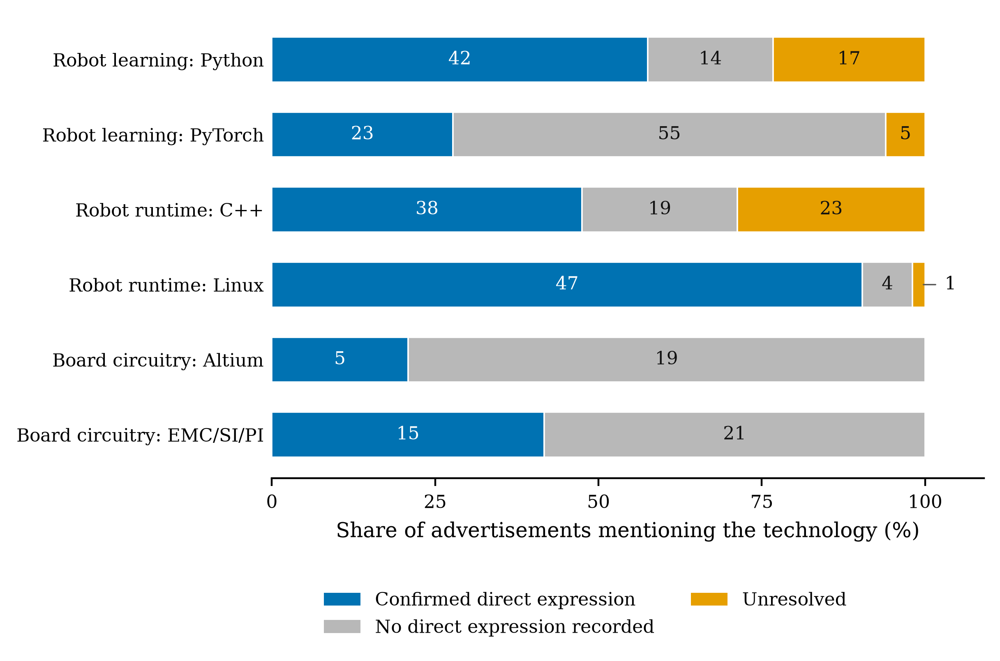
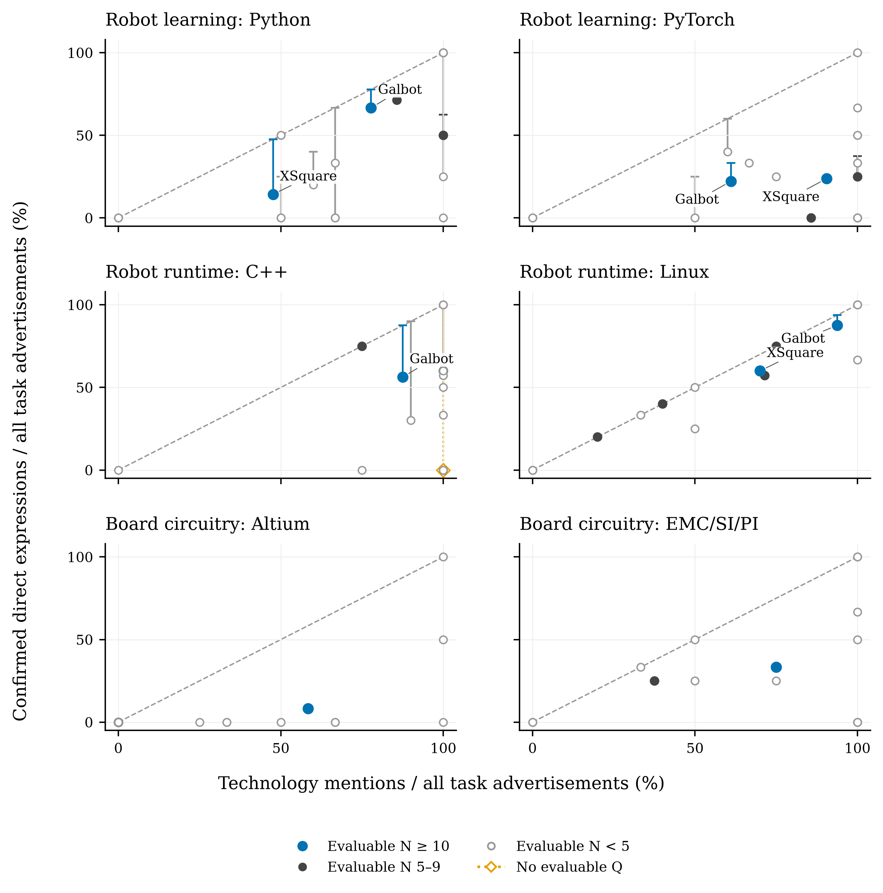

# Technology Mentions and Direct Qualification Expressions in Embodied AI Recruitment

**Purpose:** This paper examines how within-task firm comparisons change when a named technology's presence is separated from its direct specification as a candidate qualification.

**Design/methodology/approach:** A purposive corpus contains 1,654 public job advertisements from 24 entities associated with embodied artificial intelligence. The analytical sample comprises 248 advertisements, six task–technology combinations and 496 advertisement–technology observations. The analysis compares mention shares and confirmed direct-expression shares on the same task denominator, retains unresolved cases in unknown-assignment bounds and enumerates eligible firm pairs.

**Findings:** Confirmed direct expressions vary across task–technology combinations. At the main comparison threshold, the Galbot–XSquare difference ranges from +19.0 to +63.5 percentage points for Python and +27.5 to +33.8 for Linux, but from −1.6 to +9.5 for PyTorch. Adding two explicit required PyTorch statements removes the separation supported by general-qualification-only bounds. Admissible interpretations preserve the Python and Linux directions while leaving the PyTorch direction unresolved.

**Originality/value:** The paper combines established relational job-advertisement coding with fixed task denominators and bounds-supported firm comparisons. It shows how a small measurement change can narrow a local conclusion even when aggregate counts change little.

**Keywords:** job advertisements; skill requirements; firm heterogeneity; technology qualifications; embodied artificial intelligence; recruitment

**Article classification:** Research paper

## 1 Introduction

Job advertisements are widely used to study the skills that employers seek, yet the appearance of a technology name does not necessarily mean that candidates are asked to know or use it. The name may occur in a duty, describe a product or work object, or appear as one option or example. It may instead be stated directly as a qualification. This distinction becomes consequential when firms recruiting for the same task are compared: differences in mention rates can reflect how advertisements describe the work as well as how employers articulate candidate qualifications. The empirical question in this paper is therefore whether firm comparisons change when a named technology's presence is separated from its direct specification in qualification text.

Online vacancies reveal substantial variation in employer requirements within occupations, across firms and over time (Deming and Kahn, 2018; Modestino et al., 2020; Acemoglu et al., 2022). Colombo and Marcato (2023), for example, extract specific skills from Italian vacancies and relate their distribution to local labor-market concentration. Such analyses depend on what textual evidence enters a skill measure and the denominator over which it is compared. For a predefined technology, counting every occurrence answers a different question from counting advertisements that state it directly as a candidate qualification.

Semantic approaches provide tools for making this distinction. Chala et al. (2018) use information from vacancies, occupational standards and job-seeker profiles in a bidirectional matching framework. More directly, Krüger et al.'s (2025) GOJA representation models relations among work processes, tools, work objects, alternatives and requirement strength. Its applications already distinguish robots used as tools from robots treated as work objects and examine PyTorch and TensorFlow as alternatives. Building on those relational distinctions, this paper asks what firm comparisons are supported by a technology mention, a confirmed direct qualification expression and the unresolved cases between them.

Advertised qualifications are public recruitment statements rather than observations of workers' competencies. Bonesso et al. (2022) study competencies manifested in work episodes and distinguish that evidence from employers' expected skill sets in advertisements. The present analysis stays on the advertisement side of this boundary.

The analysis keeps the task denominator fixed. Let $B$ denote all sampled advertisements assigned to a given task for a firm. The mention rate, $M/B$, records the share in which the technology name appears. The confirmed direct-expression share, $P/B$, records the share with an unconditional general or explicitly required qualification. For unresolved relation or scope, unknown-assignment bounds $[P/B,(P+U)/B]$ retain all task advertisements. The evaluable-case point estimate, $P/(B-U)$, is secondary because firms can have different unresolved shares.

The study applies these measures to a purposive corpus of 1,654 public advertisements from 24 entities associated with embodied artificial intelligence. Its analytical core contains 248 advertisements in three predefined task groups: robot learning and model development, robot runtime software, and board or circuit work. Two technologies or technology families per task yield 496 advertisement–technology observations. General and required statements are combined at advertisement level without double counting, and alternative readings of ambiguous relations are examined separately.

The findings separate broad expression patterns from supported firm differences. Across the 496 observations, 170 are confirmed direct expressions and 46 are unresolved, giving full-task bounds of 34.3–43.5 per cent. The pattern varies across task–technology combinations: some names are commonly stated as qualifications, while others occur mainly in alternatives, examples or duties. At the main comparison threshold, the Galbot–XSquare difference ranges from +19.0 to +63.5 percentage points for Python and +27.5 to +33.8 for Linux, but from −1.6 to +9.5 for PyTorch. Two XSquare required statements remove the separation supported by the earlier general-qualification-only PyTorch bounds. Admissible interpretations preserve the Python and Linux directions while leaving the PyTorch direction unresolved.

The contribution is to make these changes in evidential support visible. The paper combines fixed task denominators, confirmed direct expressions and unknown-assignment bounds; separates full-task shares from conditional point estimates; and evaluates firms within task–technology cells. GOJA supplies the relational foundation, while function and work-object evidence support comparability. The design clarifies what publicly articulated technology qualifications can support in studies of recruitment and firm heterogeneity.

## 2 Data and analytical scope

### Corpus and language capture

The data comprise public job advertisements from firms whose documented work concerns humanoid or general-purpose robots, robot learning and manipulation, mobile manipulation, foundation models for physical systems, or related components, software and deployment services. Firms were selected purposively from an existing company landscape using research relevance, an identifiable organizational boundary, source quality and readable current job details with stable identifiers. This is a nonprobability sample of observable advertisements, not a census of firms, vacancies, hires or workers. An unavailable source remains unknown and does not indicate zero recruitment (Fabo and Mýtna Kureková, 2022; Tsvetkova et al., 2024).

The first snapshot contains 610 advertisements from eight firms observed on 31 August 2026. A second contains 1,044 advertisements from 16 entities observed on 11 September 2026. The accepted corpus therefore has 1,654 versioned advertisements from 24 entities. The company comparison uses 1,630 advertisements from 23 company boards; 24 advertisements from Amazon Frontier AI and Robotics remain a separately bounded team within a large corporation. “Company board” denotes the accessible recruitment source and does not imply that every vacancy was advertised.

Each record is identified by entity, source job identifier and text-version hash. Headquarters, advertised work location and source language remain separate variables. The corpus contains 963 advertisements from China-headquartered firms and 691 from United-States-headquartered firms. A geographic location is available for 800 advertisements; six other nonempty location fields name a department and 848 are missing. A deterministic classifier applied to captured title and body text identifies 957 Chinese, 676 English, six Spanish and eight Portuguese sources; seven records are too short to classify. It never infers language from country or location. Coding uses the captured source language, and English translations of quoted examples are identified as translations.

### Selection of functions and tasks

Primary function records the advertisement’s main continuing deliverable. Several independent deliverables without a dominant one form a composite category; advertisements explicitly offering alternative directions form a separate multiple-direction category. Ambiguous, unmapped and source-insufficient records remain in the denominator. Secondary functions and activities are multivalued and are not added to primary-function counts. Function, activity, work object and task are distinct: software work, for example, may deliver robot runtime, a business information system or another object.

An exploratory 84-advertisement case set examines machine-learning and artificial-intelligence (ML/AI) and software work objects at AgiBot, Galbot, Dexterity and Nimble. The technology analysis instead starts from the 23-company scope and intersects primary function with a responsibility-defined primary task: ML/AI engineering with robot-learning or model-development work (105 advertisements), robotics software with robot runtime or middleware (87), and hardware/electrical work with board-level circuitry (56). These 248 advertisements are mutually exclusive across task groups. Two previously established technologies are retained per task: Python and PyTorch; C++ and Linux; and Altium and the electromagnetic-compatibility, signal-integrity and power-integrity (EMC/SI/PI) method family. The resulting 496 advertisement–technology pairs and all 120 firm–task–technology cells are retained, including zero-positive and small cells. The task groups and technology pairs were fixed before the present union analysis but after pilot reading and earlier results; the study is exploratory and was not preregistered.

## 3 Measurement and source diagnostic

### Mentions direct qualification expressions and denominators

For each advertisement–technology pair, $M$ records any explicit mention in duties or qualifications. $G$ records a GENERAL–UNCONDITIONAL qualification: ordinary experience, familiarity or ability language not governed by choice, example, preference or unresolved scope. $R$ records REQUIRED–UNCONDITIONAL and requires an explicit mandatory statement or required-skills scope. A required-only occurrence does not also satisfy $G$, although distinct statements in one advertisement may make both positive. Proficiency wording alone does not make a statement required. Heading scope and local modifiers are read together, with the local choice or example governing the occurrence.

The main construct, $Q$, is the advertisement-level union of $G$ and $R$. It represents a named technology directly specified in a qualification statement, whether ordinary or explicitly mandatory. $Q=P$ if either constituent is positive, $Q=Z$ if both are $Z$, and $Q=U$ if neither is positive and at least one is unresolved. The union is resolved at advertisement level, so overlap is never double counted.

For every measure, $P$ denotes an explicit positive, $U$ an unresolved object, operator or scope, and $Z$ the absence of a recorded positive within adequate source and the stated coding scope. $Z$ does not mean that the employer lacks the requirement. Source exclusion and non-applicability remain separate. Let $B=P+Z+U$ be the fixed task-advertisement base. We report the confirmed-positive share $P/B$, unresolved share $U/B$, and the unknown-assignment bounds

\[P/B, (P+U)/B\]

The conditional proportion $P/(B-U)$ is reported separately and answers a narrower question about evaluable records. It is not described as the rate among all task advertisements. For firms $A$ and $B$, the corresponding difference bounds are

Δ_Q ∈ [P_A/B_A − (P_B+U_B)/B_B, (P_A+U_A)/B_A − P_B/B_B]

These finite-corpus assignment ranges are not confidence intervals and do not cover unrecognized classification error. The EMC/SI/PI measure unions explicit compatibility, interference, immunity, signal-integrity and power-integrity methods once per advertisement; Altium remains one named application.

### Author review and source reading diagnostic

The author reviewed the complete accepted corpus, introduced separate treatment for composite and alternative-direction roles, initially handled later-added categories including industrial design, and confirmed classification by substantive deliverable and actual work content. The preserved evidence supports this project-level account but does not contain an independent second code for every technology pair.

On 21 September 2026, a fixed hash seed selected up to five cases in four prior-$G$ strata within each task–technology cell, yielding 105 pairs from 94 advertisements. GPT-5.6 Sol received the target, task, title, neutral rule sheet and all distinct source fields. Prior row answers, rationales, composite identities, employer metadata and selection strata were withheld, but a mandatory high-level workspace summary had exposed aggregate project history. The output was frozen before comparison.

The GPT-6 Astra deployment in the coordinating task reread all 16 $Q$ differences and six further $G/R$ differences. Three explicit-example PyTorch cases enter the current primary revision as $U$-to-$Z$ clarifications. Ten slash or list readings retain the adjudicated primary state and supply seven coupled, rule-admissible sensitivity switches. Three fresh readings that violate the fixed modifier-scope rule enter only the all-fresh extreme stress test; the other six differences concern $G/R$ heading or bucket rules and leave $Q$ unchanged. This diagnostic assesses wording sensitivity rather than accuracy. The supplement provides the task-scope restriction, prompts, hashes, quotes and decision ledger.

### Firm comparisons

Advertisement-weighted summaries pool observed advertisements. Firm-equal summaries report two quantities: the mean fixed-base confirmed share $P/B$ across all firms with advertisements in the task, and the mean conditional proportion $P/(B-U)$ among firms with $Q_N=B-U>0$. Both retain zero-positive firms whenever the relevant denominator is positive. Every firm cell is reported with $B$, evaluable counts for $M$, $G$ and $Q$, $P/B$, $U/B$, the conditional proportion and assignment bounds.

Cross-firm comparisons use a minimum evaluable-cell rule: both firms must have at least ten evaluable observations for $M$, $G$ and $Q$ in the same task–technology cell; five is the secondary threshold. Retaining $G$ in this rule keeps $M$-, $G$- and $Q$-based comparisons on one frame. All qualifying unordered pairs are enumerated. Each pair is classified jointly by the ordering from the fixed-base mention share $M/B$ to the conditional $Q$ point estimate $P/(B-U)$ and the sign of the fixed-base difference bounds: bound-supported retention, bound-supported reversal, conditional-point reversal with overlapping bounds, or same-direction conditional points with overlapping bounds, with ties recorded separately. Exact arithmetic determines whether an endpoint equals zero. We also compare this rule with a threshold on $B$ alone and verify pair identities across scenarios.

The comparisons are descriptive and share firms and advertisements; they are not independent observations, significance tests or causal estimates. Earlier named companies serve only as illustrations within the exhaustive eligible set. A Galbot–Figure engineering example additionally uses four common functions and a symmetric Kitagawa decomposition of the pooled activity-rate difference into function-composition and within-function components (Kitagawa, 1955). Its 82 Galbot and 60 Figure advertisements and source checks are local to that example and do not replace the company-board screens.

## 4 Results

### Task technology patterns

The 248 task advertisements produce 496 advertisement–technology observations. A technology is mentioned in 348 observations (70.2 per cent). In the corrected primary layer, 170 observations contain a confirmed direct qualification expression, 280 contain no recorded positive and 46 remain unresolved. The confirmed-positive share is therefore 34.3 per cent on the fixed base of 496, while the conditional proportion among the 450 evaluable observations is 37.8 per cent. Assigning the unresolved observations to either endpoint gives a range of 34.3–43.5 per cent. The corresponding confirmed-positive share among the 348 mentions is 48.9 per cent, with an upper assignment endpoint of 62.1 per cent. These quantities answer different questions and are reported separately throughout.

The GENERAL measure contributes 165 positives. Five REQUIRED-only pairs in four advertisements—two for Python and three for PyTorch—raise the advertisement-level union, $Q$, to 170 without overlap. The three adjudicated example clarifications change PyTorch states from unresolved to no positive recorded; they increase the evaluable denominator but do not change the positive count. Table I reports all six task–technology combinations on their fixed task bases.

Table I. Technology mentions and direct qualification expressions

| Task and technology | Ads B | Mention M | Q states
P / Z / U | Confirmed
P/B % | Conditional
P/(B−U) % | Q bounds
% |
| --- | --- | --- | --- | --- | --- | --- |
| Robot learning
Python | 105 | 73 | 42 / 46 / 17 | 40.0 | 47.7 | 40.0–56.2 |
| Robot learning
PyTorch | 105 | 83 | 23 / 77 / 5 | 21.9 | 23.0 | 21.9–26.7 |
| Robot runtime
C++ | 87 | 80 | 38 / 26 / 23 | 43.7 | 59.4 | 43.7–70.1 |
| Robot runtime
Linux | 87 | 52 | 47 / 39 / 1 | 54.0 | 54.7 | 54.0–55.2 |
| Board circuitry
Altium | 56 | 24 | 5 / 51 / 0 | 8.9 | 8.9 | 8.9–8.9 |
| Board circuitry
EMC/SI/PI | 56 | 36 | 15 / 41 / 0 | 26.8 | 26.8 | 26.8–26.8 |

Notes: Q is the advertisement-level union of unconditional GENERAL and REQUIRED expressions. P denotes a confirmed positive, Z no recorded positive within the coding scope, and U unresolved scope. Bounds are [P/B, (P+U)/B], not confidence intervals. Conditional proportions exclude U. Robot learning includes model development. EMC/SI/PI denotes the compatibility, signal-integrity and power-integrity method family. The two technologies within each task reuse the same advertisements. Source: calculations from the captured job-advertisement corpus.

The contrast between mentions and direct expressions varies across the selected combinations. Python appears in 73 of 105 robot-learning and model-development advertisements; 42 are confirmed $Q$ positives, 46 have no positive recorded and 17 are unresolved. Its confirmed share is 40.0 per cent, its conditional proportion 47.7 per cent and its assignment range 40.0–56.2 per cent. PyTorch is mentioned more often, in 83 of 105 advertisements, but has 23 positives, 77 nonpositives and five unresolved cases. Its corresponding values are 21.9 per cent, 23.0 per cent and 21.9–26.7 per cent.

The robot-runtime combinations differ in another way. C++ is mentioned in 80 of 87 advertisements, but 23 direct-expression states remain unresolved; its confirmed share is 43.7 per cent and its assignment range is 43.7–70.1 per cent. Linux is mentioned in 52 of 87 advertisements and has 47 positives, 39 nonpositives and one unresolved case, giving a much narrower range of 54.0–55.2 per cent. In board-circuitry advertisements, Altium has five confirmed positives on a base of 56 (8.9 per cent), while the EMC/SI/PI family has 15 (26.8 per cent); neither combination has an unresolved state.

Figure 1 conditions on the advertisements that mention each technology and displays their qualification context. Among PyTorch mentions, 23 are confirmed positives, 55 have no positive recorded and five remain unresolved. The corresponding Linux composition is 47, four and one. C++ combines 38 positives with 19 nonpositives and 23 unresolved mentions. These patterns concern task–technology combinations: they do not isolate a technology effect from differences between robot learning, runtime software and circuitry work.

Figure 1. Qualification context among technology mentions

Notes: Counts partition observed mentions into confirmed Q positives, no direct expression recorded and unresolved states in the corrected analysis. The narrow Linux unresolved segment is labelled outside the bar. Task–technology combinations differ in both their tasks and technologies.

### Firm coverage and the three main comparisons

The firm analysis retains all 120 firm–task–technology cells: 22 firms for each robot-learning technology, 20 for each runtime technology and 18 for each circuitry indicator. Figure 2 places the mention share $M/B$ and confirmed direct-expression share $P/B$ on the same fixed task base; vertical segments show the assignment range generated by recorded unresolved states. This avoids interpreting a change in the conditional denominator as a semantic gap. Three C++ cells have no evaluable conditional point, but remain visible with a confirmed share of zero and a 0–100 per cent assignment range.

Figure 2. Mentions and confirmed direct expressions on the same task base

Notes: Both axes use all B advertisements in the firm–task cell. Markers show the confirmed-positive share P/B; vertical lines extend to (P+U)/B and are unknown-assignment bounds. All 120 cells are plotted; coincident marks can overlap. The three all-unknown C++ cells have zero confirmed positives and ranges from 0 to 100 per cent, shown with hollow diamonds and dotted lines. Their zero confirmed shares do not imply that direct expressions are absent. N is the minimum evaluable count in M, G and Q. The diagonal represents equality on the same denominator.

The minimum evaluable-cell rule further distinguishes task coverage from comparative coverage. At the threshold of ten, ten cells meet the advertisement-count requirement $B\geq10$, but one fails the evaluability requirement, leaving nine eligible cells. Only three unordered comparisons result—one each for Python, PyTorch and Linux—and all compare Galbot with XSquare. At the threshold of five, 26 cells meet the advertisement-count requirement and 21 meet the full $M/G/Q$ evaluability rule, producing 32 unordered pairs. The three threshold-ten rows recur within those 32 rows; the two thresholds do not provide 35 independent comparisons.

Table II shows the three main differences as Galbot minus XSquare. Python retains the mention direction under every assignment of recorded unknowns. Galbot mentions Python in 14 of 18 advertisements, compared with 10 of 21 at XSquare, for a mention gap of 30.2 percentage points. Confirmed direct expressions occur in 12/18 and 3/21, a fixed-base gap of 52.4 points. The conditional gap is 53.6 points, and the full difference range remains positive at 19.0–63.5 points.

Table II. Main company differences on fixed and evaluable task bases

| Technology | Mention gap
pp | Confirmed Q gap
pp | Conditional Q gap
pp | Q difference bounds
pp | Interpretation |
| --- | --- | --- | --- | --- | --- |
| Python | +30.2 | +52.4 | +53.6 | +19.0 to +63.5 | Supported retention |
| PyTorch | -29.4 | -1.6 | +1.2 | -1.6 to +9.5 | Conditional reversal; bounds overlap |
| Linux | +23.8 | +27.5 | +33.3 | +27.5 to +33.8 | Supported retention |

Notes: All gaps are Galbot minus XSquare. Task bases are 18 and 21 advertisements for Python and PyTorch, and 16 and 10 for Linux. M and confirmed Q use these full bases. Conditional Q excludes each firm’s U cases. Q difference bounds assign unknowns in the two firms to opposite endpoints. All three comparisons pass the minimum evaluable-cell threshold of ten; they reuse the same two firms and are not independent replications. Positive bounds support Galbot’s higher direct-expression share. Source: calculations from the captured job-advertisement corpus.

PyTorch does not support a firm ordering on the full task base. XSquare has the higher mention share: 19/21 compared with Galbot's 11/18, so the Galbot-minus-XSquare mention gap is −29.4 points. The confirmed direct-expression shares are 4/18 and 5/21, a gap of −1.6 points that also favors XSquare. Because Galbot has two unresolved cases and XSquare none, conditioning on evaluable records gives 4/16 versus 5/21, reversing only the conditional point ordering by 1.2 points. The fixed-base difference range, −1.6 to 9.5 points, crosses zero. Thus the data support neither a Galbot nor an XSquare PyTorch ordering under all assignments of the recorded unknowns.

The PyTorch comparison nevertheless shows why REQUIRED expressions matter. Before they are added, the GENERAL bounds favor Galbot: the Galbot-minus-XSquare range is 7.9–19.0 points. Two XSquare advertisements state PyTorch directly under required qualifications. Incorporating them changes the confirmed-share direction and makes the union bounds overlap. The result is a loss of directional support, rather than an established reversal in the full task sample.

Linux retains its direction. Galbot mentions Linux in 15 of 16 advertisements and XSquare in 7 of 10, a gap of 23.8 points. Confirmed direct expressions occur in 14/16 and 6/10, and the difference range is 27.5–33.8 points; the conditional gap is 33.3 points. Python and Linux therefore provide bound-supported retention, whereas PyTorch provides a conditional-point reversal with overlapping bounds.

Table III extends this joint classification to every eligible pair. At the threshold of ten, the totals are two bound-supported retentions, no bound-supported reversal, one conditional-point reversal with overlapping bounds and no same-direction overlapping comparison. In the corrected primary layer, the 32 threshold-five comparisons comprise 22 bound-supported retentions, five bound-supported reversals, three conditional-point reversals with overlapping bounds and two same-direction conditional comparisons with overlapping bounds. Python contributes three supported retentions, two supported reversals and one conditional reversal; PyTorch contributes three, one, one and one; C++ contributes no supported retention, one supported reversal and one of each overlapping type. Linux contributes 14 supported retentions and one supported reversal, while the two circuitry comparisons are supported retentions. No mention tie, conditional-point tie or difference-bound endpoint equal to zero occurs.

Table III. Conditional ordering and fixed-base bounds for all eligible comparisons

| Min N | Task and technology | Pairs | Supported retention | Supported reversal | Conditional reversal with overlap | Same direction with overlap |
| --- | --- | --- | --- | --- | --- | --- |
| 10 | All combinations | 3 | 2 | 0 | 1 | 0 |
| 5 | Robot learning
Python | 6 | 3 | 2 | 1 | 0 |
| 5 | Robot learning
PyTorch | 6 | 3 | 1 | 1 | 1 |
| 5 | Robot runtime
C++ | 3 | 0 | 1 | 1 | 1 |
| 5 | Robot runtime
Linux | 15 | 14 | 1 | 0 | 0 |
| 5 | Board circuitry
Altium | 1 | 1 | 0 | 0 | 0 |
| 5 | Board circuitry
EMC/SI/PI | 1 | 1 | 0 | 0 | 0 |
| 5 | All combinations | 32 | 22 | 5 | 3 | 2 |

Notes: Each firm must meet the minimum separately for evaluable M, G and Q; N is their minimum. Retention and reversal are relative to mention ordering. Supported categories require the Q difference bounds to exclude zero. Overlap categories describe conditional point ordering only. No mention tie, conditional tie or zero bound endpoint occurs. The 32 comparisons at five include all three comparisons at ten; rows share firms and advertisements. Bounds are finite-corpus assignment ranges, not sampling intervals. Source: calculations from the captured job-advertisement corpus.

### Semantic adjudication and sensitivity

Three complete phrases explicitly place PyTorch inside example constructions and are corrected from $U$ to $Z$ in the primary analysis. Ten list or slash readings remain contestable and form seven coupled, rule-admissible switches. Three fresh $Q$ readings that disregard explicit example scope or a local modifier enter only the all-fresh extreme scenario; item identities and the decision ledger are reported in the supplement.

All 128 combinations of the seven admissible switches retain the same three threshold-ten and 32 threshold-five pair keys. For the main comparisons, Python remains bound-supported in Galbot's direction: its combined semantic-and-unknown range is 19.0–63.5 points. PyTorch remains directionally unresolved in every combination. Its conditional gap ranges from −0.28 to +1.19 points, while the combined difference range is −1.6 to +9.5 points. Linux also retains directional support; across semantic readings and unknown assignments its range is 17.5–33.8 points, compared with 27.5–33.8 points in the corrected primary layer.

The lower-threshold evidence is similarly concentrated. Twenty-two supported retentions and five supported reversals occur in every admissible reading. A sixth reversal is bound-supported under some readings, so the number of supported reversals ranges from five to six rather than being fixed at the eight conditional point reversals in the primary layer. Turning on all seven admissible switches yields 179 positives and 39 unresolved observations and classifies the 32 pairs as 22 supported retentions, six supported reversals, one conditional reversal with overlapping bounds and three same-direction conditional comparisons with overlapping bounds.

The all-fresh extreme is kept separate because it also adopts the three rule-inconsistent scope readings and the six $G/R$-only fresh differences. It yields 180 positives and 39 unresolved observations and happens to produce the same four pair-classification counts as the all-switch admissible endpoint; that numerical coincidence does not give the two scenarios the same evidential status. Finally, excluding the four task-boundary advertisements leaves 244 advertisements, 488 advertisement–technology observations and $Q$ states of 169 positive, 274 nonpositive and 45 unresolved. It preserves the corrected-primary pair keys and classifications. The stable findings are the bound-supported Python and Linux directions, the absence of a supported PyTorch ordering, and the persistence of most lower-threshold classifications across admissible readings.

## 5 Discussion

The results show why mentions, confirmed direct qualification expressions and unresolved cases should be kept distinct. Across the six task–technology combinations, 348 of 496 observations contain a mention, while 170 contain a confirmed direct expression and 46 remain unresolved. On the common task base, the direct-expression share lies between 34.3 and 43.5 per cent. Linux in robot-runtime advertisements is usually stated directly when mentioned, whereas PyTorch in robot-learning advertisements more often appears in alternatives, examples or other contexts. This pattern describes the selected task–technology combinations rather than either technology alone.

The main firm comparisons demonstrate the value of the full task denominator. For Galbot relative to XSquare, the Python difference ranges from +19.0 to +63.5 percentage points and the Linux difference from +27.5 to +33.8; both preserve the mention direction. The PyTorch range, −1.6 to +9.5 points, crosses zero. Its evaluable-case point difference is +1.2 points, while its confirmed-positive difference on the full task base is −1.6 points, so the evidence does not establish an ordering. Two XSquare required statements remove the separation supported by the earlier general-qualification-only bounds. A small addition to the measure can therefore narrow a local conclusion without a large aggregate change.

At the main threshold, two of three comparisons preserve the mention direction with bounds support; PyTorch is a conditional point reversal with overlapping bounds. At the lower threshold, 22 of 32 comparisons are bounds-supported retentions and five are bounds-supported reversals. Three are conditional point reversals with overlapping bounds and two have aligned conditional points with overlapping bounds. Firms and advertisements recur across pairs, and the lower threshold admits smaller cells, so these remain descriptive comparisons.

Across all admissible interpretations, the two supported main-threshold directions remain, while PyTorch remains unresolved and its conditional point difference ranges from −0.3 to +1.2 percentage points. Python is unchanged, and the combined semantic and unknown-assignment envelope for Linux remains positive at +17.5 to +33.8 points. At the lower threshold, all 22 supported retentions and five supported reversals persist; one additional reversal gains support under some readings. The extreme fresh-reading replacement includes readings outside the stated scope rules and therefore has a different evidential status.

The findings extend vacancy-based skill measurement before named technologies are aggregated. Colombo and Marcato (2023) show how detailed vacancy measures can inform a labor-market question; here, the relation asserted around a technology affects the firm comparison. Chala et al. (2018) demonstrate a semantic recruitment application, while the present objective is interpretable measurement. GOJA provides the relational treatment of tools, work objects, alternatives and requirement strength (Krüger et al., 2025); the increment here is to apply those relations with fixed task denominators, unresolved states and bounds-supported comparisons. Advertised qualifications also remain distinct from competencies enacted at work (Bonesso et al., 2022).

For recruitment and human resource (HR) analytics, the measures allow a technology stated as a qualification to be separated from one appearing in a duty, example or alternative. Requisitions for the same task can be reviewed on a common denominator, while ambiguous wording remains visible when skill inventories or screening rubrics are constructed.

The study covers purposively selected firms and fixed collection dates. Common tasks improve comparability but do not equalize seniority, templates, locations or work objects. The bounds cover recorded unresolved states rather than every possible error, and advertisements capture recruitment language rather than hires or worker capability. Repeated collections, more comparable firm cells and later-stage hiring evidence would show how far the patterns extend.

## 6 Conclusion

Firm comparisons based on job advertisements depend on both the relation around a named technology and the denominator used to summarize it. With all task advertisements retained, the Python and Linux differences remain directionally supported, whereas the PyTorch comparison spans zero. Adding two explicit required PyTorch statements removes the separation implied by the earlier general-qualification-only bounds, illustrating how a small measurement change can narrow a local conclusion.

The paper combines established relational coding with fixed task denominators, confirmed direct-expression shares and unknown-assignment bounds. This approach distinguishes supported differences from changes that occur only among evaluable cases. For labor and HR research, retaining the relation and its unresolved cases before aggregating named technologies provides a clearer account of what public recruitment text can support.

## Data availability

The accompanying research package contains versioned analytical inputs, source excerpts and identifiers for the task sample, final states, all firm cells and comparisons, the complete diagnostic and executable reproduction scripts. The package README maps each table and figure to its inputs and computation. A public archive has not yet been established. Captured advertisements remain third-party materials; their inclusion for verification does not imply permission for unrestricted redistribution.

## References

Acemoglu, D., Autor, D., Hazell, J. and Restrepo, P. (2022), "Artificial intelligence and jobs: evidence from online vacancies", *Journal of Labor Economics*, Vol. 40 No. S1, pp. S293–S340. https://doi.org/10.1086/718327

Bonesso, S., Gerli, F. and Bruni, E. (2022), "The emotional and social side of analytics professionals: an exploratory study of the behavioral profile of data scientists and data analysts", *International Journal of Manpower*, Vol. 43 No. 9, pp. 19–41. https://doi.org/10.1108/IJM-07-2020-0342

Chala, S.A., Ansari, F., Fathi, M. and Tijdens, K. (2018), "Semantic matching of job seeker to vacancy: a bidirectional approach", *International Journal of Manpower*, Vol. 39 No. 8, pp. 1047–1063. https://doi.org/10.1108/IJM-10-2018-0331

Colombo, E. and Marcato, A. (2023), "Skill demand and labour market concentration: evidence from Italian vacancies", *International Journal of Manpower*, Vol. 44 No. 9, pp. 156–198. https://doi.org/10.1108/IJM-04-2023-0181

Deming, D. and Kahn, L.B. (2018), "Skill requirements across firms and labor markets: evidence from job postings for professionals", *Journal of Labor Economics*, Vol. 36 No. S1, pp. S337–S369. https://doi.org/10.1086/694106

Fabo, B. and Mýtna Kureková, L. (2022), "Methodological issues related to the use of online labour market data", ILO Working Paper No. 68, International Labour Organization, Geneva. https://doi.org/10.54394/ZZBC8484

Kitagawa, E.M. (1955), "Components of a difference between two rates", *Journal of the American Statistical Association*, Vol. 50 No. 272, pp. 1168–1194. https://doi.org/10.1080/01621459.1955.10501299

Krüger, K., Binnewitt, J., Ehmann, K., Winnige, S. and Akbik, A. (2025), "Improving online job advertisement analysis via compositional entity extraction", in Christodoulopoulos, C., Chakraborty, T., Rose, C. and Peng, V. (Eds), *Proceedings of the 2025 Conference on Empirical Methods in Natural Language Processing*, Association for Computational Linguistics, Suzhou, pp. 27047–27065. https://doi.org/10.18653/v1/2025.emnlp-main.1375

Modestino, A.S., Shoag, D. and Ballance, J. (2020), "Upskilling: do employers demand greater skill when workers are plentiful?", *Review of Economics and Statistics*, Vol. 102 No. 4, pp. 793–805. https://doi.org/10.1162/rest_a_00835

Tsvetkova, A., D'Amico, E., Lembcke, A., Knutsson, P. and Vermeulen, W. (2024), "How well do online job postings match national sources in large English speaking countries? Benchmarking Lightcast data against statistical sources across regions, sectors and occupations", OECD Local Economic and Employment Development (LEED) Papers, No. 2024/01, OECD Publishing, Paris. https://doi.org/10.1787/c17cae09-en
