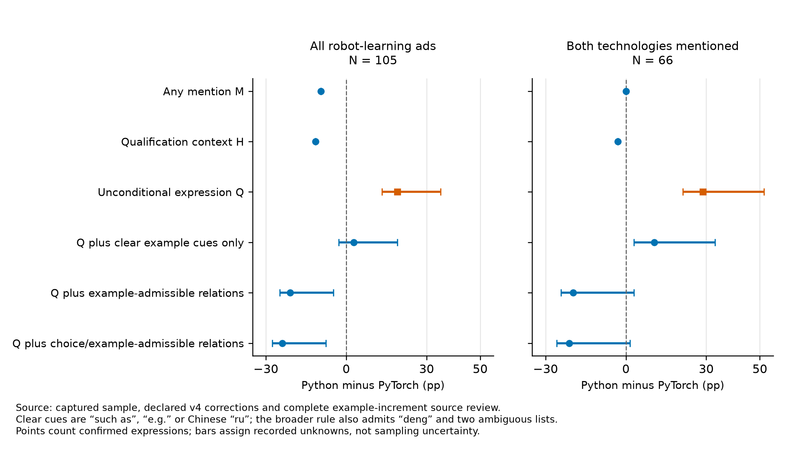

# INTERNAL AI-ASSISTED AUTHOR RESEARCH WORKING DRAFT — NOT A SUBMISSION MANUSCRIPT

This is an internal research work product prepared with generative-AI assistance. It is not certified as compliant with *International Journal of Manpower* or Emerald policy and must not be represented as independently authored submission prose. Human author metadata remain unset. Reported computations have separate implementation checks, while the source interpretation remains model-assisted rather than independently human coded.

# What Counts as a Technology Qualification in Embodied AI Hiring?

**Human author(s), affiliations and correspondence:** [TO BE COMPLETED BY THE HUMAN AUTHOR(S)]

## Structured abstract

**Purpose:** Vacancy research often treats named technologies as employer skill demand. This paper asks how measured demand changes when a technology's location in qualification text and the linguistic operator governing it are preserved.

**Design/methodology/approach:** A purposive corpus contains 1,654 public advertisements from 24 entities associated with embodied artificial intelligence. The main sample pairs two fixed technologies within each of 248 advertisements for robot learning, robotics software or board circuitry. The analysis distinguishes mentions, occurrences anywhere in qualification context and unconditional technology-specific qualification statements. It retains unresolved states and tests alternative treatment of examples and choices.

**Findings:** In 105 robot-learning advertisements, PyTorch is mentioned more often than Python and appears more often somewhere in qualification context. Under the narrow unconditional-statement construct, Python's confirmed share is 19.0 percentage points higher. When all recorded example-admissible relations count, the ordering reverses and PyTorch's share is 21.0 points higher. Among 66 advertisements naming both, the narrow construct favors Python, while the example-inclusive range crosses zero. Robotics-software and circuitry pairs show different transitions.

**Originality/value:** Skill-demand ordering can depend on the qualification estimand, not only extraction accuracy or sample size. The paper separates technology visibility, qualification context and unconditional technology-specific expression before comparing firms or technologies.

**Keywords:** job advertisements; skill demand; qualification language; measurement; embodied artificial intelligence; recruitment

**Article classification:** Research paper

## 1. Introduction

Online job advertisements are widely used to measure employer skill demand. Researchers use named technologies to track new capabilities, compare firms and occupations, and study how production changes affect workers (Deming and Kahn, 2018; Acemoglu et al., 2022; Alekseeva et al., 2021). Yet a technology in qualification text need not be stated in the same way. “Experience with PyTorch” identifies the target without qualification. “Experience with frameworks such as PyTorch” places it inside an example class. “Python or C++” offers a choice. These passages may all be informative to applicants; they do not define the same empirical object.

Robot-learning advertisements expose this boundary. The study observes 105 advertisements and two fixed targets in each. PyTorch is named in 83 advertisements and Python in 73. PyTorch also appears somewhere in known qualification context more often, 79 advertisements against 67. A narrow measure requiring an unconditional technology-specific qualification statement gives the opposite ordering: 42 Python positives and 22 PyTorch positives. Python's confirmed share is then 19.0 percentage points higher, with an outer recorded-unknown range of +13.3 to +35.2 points.

That contrast is not evidence that employers demand Python more. It depends on what the measure does with examples. If every recorded example-admissible relation within GENERAL or REQUIRED qualification context counts as target evidence, the same advertisements give 43 Python and 65 PyTorch positives. The Python-minus-PyTorch range becomes −24.8 to −4.8 points. Expanding the admitted relation set further to include choices yields 50 and 75 positives and a range of −27.6 to −7.6. The ordering therefore changes twice: PyTorch leads in mentions and qualification-context occurrence, Python leads under the unconditional target-specific construct, and PyTorch leads when all recorded example-admissible relations count.

Pairing within advertisements clarifies but does not remove the construct problem. Among 66 robot-learning advertisements naming both technologies, 60 place Python and 62 place PyTorch somewhere in qualification context. Under the narrow construct, 37 unconditionally specify Python and 18 PyTorch; the difference range is +21.2 to +51.5 points. Including all recorded example-admissible relations gives 38 and 51 positives and a range of −24.2 to +3.0. The same source texts support different answers because the estimands ask different questions.

The central question is therefore: **what counts as a technology qualification in vacancy research?** This paper distinguishes three textual layers. A mention establishes technology visibility. A qualification-context occurrence establishes that the name participates in a preserved GENERAL or REQUIRED branch, including alternatives, examples, conditional expressions and unresolved branches. A confirmed unconditional technology-specific statement establishes that the target is stated without a choice, example, conditional or unresolved operator. Their confirmed-positive indicators satisfy \(Q^P\subseteq H\subseteq M\), but none is a universal measure of latent employer demand. A PREFERRED-only occurrence can enter M because it names the target, but the separate PREFERRED metric is excluded from H, Q and their expansions.

This distinction connects labor-demand measurement and recruitment research. Detailed vacancy skills vary within occupations and firms and predict economically relevant outcomes (Deming and Kahn, 2018). Advertised requirements also respond to labor-market conditions, so observed wording need not be a pure readout of production technology (Modestino et al., 2020). Posting-based indicators often correspond to skills workers later report using, but they miss intensity and context (Daly et al., 2025). In a questionnaire experiment with senior engineering students classified as qualified or unqualified by cumulative GPA, recruitment-advertising specificity changed stated response likelihood (Mason and Belt, 1986). A framework example may communicate acceptable experience without making the framework mandatory; excluding it may understate applicant relevance, while counting it as a target requirement may overstate specificity.

Semantic vacancy research represents tools, work objects, alternatives and requirement strength (Krüger et al., 2025), while matching research connects structured vacancy information to candidate profiles (Chala et al., 2018). Economic work has also shown why textual location matters. Kalyani et al. (2025), for example, distinguish technology language in company descriptions from tasks and distinguish use from production, supported by human audit. The present candidate-qualification and operator boundary is narrower. Its contribution is not a new extractor or a claim that contextual distinctions are unprecedented. It demonstrates that defensible qualification constructs generate different technology orderings in the same advertisements. The 128 saved semantic readings address uncertainty within the original narrow construct. Counting example branches changes the construct itself. More observations cannot settle that definitional choice.

The other task pairs delimit the claim. Robotics-software advertisements show that C++ is more visible and more prevalent in qualification context than Linux, while the narrow measure cannot order them on the full task base because many C++ states are unresolved. Circuitry advertisements move from more EMC/SI/PI mentions to nearly equal qualification-context coverage, then back to more EMC/SI/PI under the narrow construct. Firm rankings are weaker still: the earlier strict threshold contains one company pair, and most lower-threshold reversals lose support after one adverse resolved-state change.

Section 2 defines the layers and their interpretation. Section 3 describes the corpus and sensitivity designs. Section 4 shows ordering changes across constructs and paired samples. Section 5 discusses implications for labor-demand and HR research.

## 2. Three layers of technology evidence

Let \(B\) contain every sampled advertisement assigned to a fixed task. For target \(t\), \(M_t\) records an explicit mention anywhere in captured duties or qualifications. It measures technology visibility.

The second layer, \(H_t\), records a preserved occurrence in any known GENERAL or REQUIRED qualification branch. It includes unconditional expressions and occurrences governed by choice, example, conditional or other recorded branches. It excludes the separate PREFERRED metric. It does not say the target itself is mandatory or independently sufficient. It establishes qualification-context association within those two metrics.

The third layer assigns a narrow-Q state \(S^Q_t\in\{P,Z,U\}\). A confirmed-positive indicator, \(Q^P_t=1(S^Q_t=P)\), records an unconditional technology-specific qualification statement. It combines ordinary GENERAL and explicitly mandatory REQUIRED expressions only when the target is not governed by choice, example, conditional or unresolved scope. Required-only occurrences enter once. A U state is not treated as a confirmed Q positive, even though the target can still be observed in H and M.

The labels impose necessary limits. \(H\) is too broad to call a target-specific requirement: “frameworks such as PyTorch” may describe a non-exhaustive class. \(Q\) is too narrow to represent all applicant relevance: the example can indicate that PyTorch experience counts even if equivalent frameworks also qualify. The paper therefore avoids treating either as true demand.

This is a construct-validity problem with a comparison consequence. Within a target, nesting guarantees that its confirmed Q count cannot exceed H and its H count cannot exceed M. Across targets, however, the amount lost at each boundary can differ. A technology commonly presented as one example of a family may have high M and H but low confirmed Q. A language stated directly may retain more of its mentions in Q. Comparing Q shares then compares unconditional expression, not the full set of ways each technology is relevant. Conversely, comparing M shares treats a name in duties, a broad example and a direct candidate statement alike. Neither contrast recovers a scalar latent demand without additional assumptions linking textual form to screening or use.

The distinction also bears on measurement invariance. If technologies are conventionally written with different operators, one coding rule need not have the same meaning across targets. The present analysis cannot determine whether that convention reflects substitutability, recruiter style, maturity of the technology or differences between languages and framework families. It can test a prior requirement for such explanations: whether the observed ordering survives explicit, documented changes in the relation being counted. The answer for Python and PyTorch is no.

Two alternatives locate the boundary. \(Q+E\) expands the admitted relation set beyond unconditional Q to include example readings. \(Q+C+E\) expands that relation set further to include choice readings. They answer different questions: whether the target is stated unconditionally; whether it is unconditional or an example; and whether it is unconditional, an example or one member of a choice set. Conditional branches and the separate PREFERRED metric remain outside these alternatives. P, Z and U are evaluated for each construct: a Q-unknown can become positive under an expansion when every live reading belongs to the newly admitted relation set.

All layers are traceable to saved context evidence. Source spans and hashes were checked, and a separate implementation reproduced the scope construction, aggregates and rowwise nesting \(Q^P\subseteq H\subseteq M\). This computational agreement does not provide independent human validation of the underlying semantic judgments.

For narrow Q, let \(P_t\), \(Z_t\) and \(U_t\) be positive, nonpositive and unresolved counts. \(Z\) means no positive under this construct, not that the employer lacks the skill. The confirmed share and outer assignment range are

\[
P_t/B,\qquad [P_t/B,(P_t+U_t)/B].
\]

For two targets in the same advertisements, the difference range is

\[
[(P_a-P_b-U_b)/B,(P_a+U_a-P_b)/B].
\]

These conservative ranges allow the unknowns recorded for that construct to move adversely. They are not confidence intervals or exhaustive semantic sets. Expanded constructs propagate the saved relation evidence under their own admission rule. Ambiguity remains U only when it can still change inclusion under that rule; ambiguity wholly within the admitted set becomes P.

The confirmed-share contrast also has a useful arithmetic decomposition. Define \(\Delta_H=\Pr(H_a=1)-\Pr(H_b=1)\) and \(\Delta_Q=\Pr(Q^P_a=1)-\Pr(Q^P_b=1)\) over the same advertisements. Because confirmed Q is nested in H,

\[
\Delta_Q=\Delta_H-\{\Pr(H_a=1,Q^P_a=0)-\Pr(H_b=1,Q^P_b=0)\}.
\]

Thus a target can lead in H but trail in Q when a larger share of its qualification-context occurrences is excluded from confirmed Q by the operator rule. The identity also applies to normalized positive weights. It is an accounting description of where the contrast changes, not a new identification result or evidence about why employers use different operators.

The nested objects are entirely textual: \(Q^P\subseteq H\subseteq M\). Actual screening, hiring and subsequent skill use are external validity outcomes, not further members of that set relation. The corpus contains none of those outcomes and does not imply that a confirmed Q statement becomes a screen or that an H occurrence does not.

## 3. Data and methods

The corpus contains 1,654 versioned public advertisements from 24 entities associated with embodied artificial intelligence. Eight firms contributed 610 advertisements captured on 31 August 2026; 16 additional entities contributed 1,044 captured on 11 September. Selection was purposive and required research relevance, an identifiable organizational boundary, readable job details and stable identifiers. The corpus is not a census of firms, vacancies, hires or workers.

Each record joins entity, source job identifier and text-version hash. Primary function records the main continuing deliverable. Task membership intersects function with responsibility evidence. The paired sample contains 105 machine-learning and AI engineering advertisements assigned to robot learning or model development, 87 advertisements assigned to a broader robotics-software task under the documented function-and-responsibility rule, and 56 hardware or electrical advertisements assigned to board circuitry. The robotics-software task includes relevant product-stack and infrastructure roles and should not be read as a pure runtime or middleware population.

Coding and validation are separate stages. The project used model-assisted source reading and coordinating adjudication to apply task, function and technology-relation rules to the accepted corpus. The relation records preserve the source span, qualification metric, governing branch and state rather than only a final binary indicator. Deterministic scripts then join those records to the paired task sample and construct M, H, Q and the scope alternatives. The human author reviewed the accepted corpus and resolved project-level task and function rules, but the package does not contain an independent human second code for every technology relation. The analysis therefore treats traceability and reproducible computation as necessary evidence, not as substitutes for semantic validation.

The audit design reflects that distinction. Identity checks test whether the same advertisement and text version are compared. Span and hash checks test whether a recorded relation points to the preserved source. Independent implementations test whether joins, weights, state transitions and reported aggregates follow the encoded rules. None of these tests answers whether a recruiter or applicant would assign the same operator, or whether the chosen construct corresponds to later screening behavior. This separation follows the broader warning that automated text measures require validation for the research task in which they are used (Grimmer and Stewart, 2013; Park and Montgomery, 2025).

Two previously selected targets are retained per task: Python and PyTorch; C++ and Linux; and Altium and the EMC/SI/PI method family. Every advertisement has two target rows, yielding 496 records. Targets were fixed before the present paired and scope analyses but after pilot reading and earlier results. The analysis is exploratory and was not preregistered.

Pairing ensures that target rows use the same advertisements. Company, wave, location field and full text are identical across a pair. It does not make technologies exchangeable, equalize their clauses, or identify a technology effect. The common-mention subset requires both names in the same advertisement. It removes name absence as an explanation but selects advertisements that may be longer or technically broader.

The analysis therefore uses three comparison frames. The task base asks how often each fixed target appears or enters a qualification construct among advertisements assigned to the same work domain. The common-mention base asks how two named technologies are related to candidate qualifications after both are visible in the text. Firm-equal and exact-repeat weights ask whether one employer or repeated captured text dominates the narrow-Q pattern. None is a control design for unobserved vacancy characteristics. In particular, same-advertisement pairing holds the document fixed but does not hold the semantic role of two technologies fixed.

Primary results weight advertisements equally. Firm-equal results average shares across firms in the relevant sample. A third scheme normalizes exact full qualification-text repeats within firms using Unicode NFKC, case and whitespace normalization, then weights firms equally. It identifies 99 exact clusters among 105 robot-learning advertisements; robotics-software and circuitry texts are all distinct under this rule. It does not detect near duplicates.

A post hoc local-text diagnostic targets repeated target-specific parent clauses that full-text matching misses. Within each firm, it groups advertisements by the joint normalized local qualification text and scope signature for both targets, assigns equal weight to distinct groups, and then equal weight to advertisements within a group. An advertisement-specific fallback applies when target evidence is absent or cannot be located within the requirements field. The robot-learning sample has 95 local groups; six repeated groups contain 16 advertisements. This weighting measures concentration in repeated local wording. It does not identify shared templates across differently worded clauses or control company style, seniority or job composition.

The original narrow Q has seven coupled reading switches covering ten slash or list disputes. All \(2^7 = 128\) combinations are enumerated. They do not exhaust semantic uncertainty or decide whether examples belong in the estimand. Firm comparisons require minimum evaluable counts of ten or five for mention, GENERAL and narrow Q. A post hoc breakdown finds the smallest adverse resolved \(P\leftrightarrow Z\) changes needed to remove strict support. It is a finite-state distance, not an estimated error count.

After the Python–PyTorch pattern was known, an exploratory same-class control compared PyTorch with TensorFlow in the same 105 robot-learning advertisements. A protocol was frozen before coding the new TensorFlow relation states. Literal matching found 26 TensorFlow advertisements, all also naming PyTorch; all 79 nonmatches were checked, and all 26 matched full sources were reviewed. This is an after-discovery extension, not a preregistered test, a holdout sample or an independent validation set.

Results are descriptive for the captured finite corpus. The tables report counts, percentage-point differences and assignment ranges rather than sampling standard errors or population p-values. The ranges move recorded unresolved states to adverse endpoints within a named construct. They do not protect against incorrect resolved labels, omitted advertisements, an unsuitable task definition or the decision to include examples. Separating these sources of uncertainty prevents a narrow arithmetic sensitivity analysis from being presented as broad semantic robustness.

## 4. Results

### 4.1. Technology ordering changes with the qualification construct

Table I presents the central result. PyTorch leads Python on the broad layers: by 9.5 points in mentions and 11.4 in qualification-context association. Narrow Q reverses the ordering. Python has 42 positives and 17 unknowns; PyTorch has 22 and six. The confirmed gap is +19.0 points and remains positive at +13.3 to +35.2 under recorded unknown assignment.

Counting every recorded example-admissible relation reverses the result again. \(Q+E\) gives 43 Python and 65 PyTorch positives, with a range of −24.8 to −4.8. Adding choices produces 50 and 75 positives and −27.6 to −7.6. “Python demand exceeds PyTorch demand” is therefore unsupported unless the qualification relation is named.

**Table I. Technology ordering across qualification constructs**

| Task and contrast A−B | Construct | A | B | Gap pp | Difference range pp |
| --- | --- | ---: | ---: | ---: | ---: |
| Python−PyTorch, 105 ads | Mention M | 73 | 83 | −9.5 | −9.5 to −9.5 |
|  | Qualification context H | 67 | 79 | −11.4 | −11.4 to −11.4 |
|  | Unconditional Q | 42 | 22 | +19.0 | +13.3 to +35.2 |
|  | Q plus all recorded examples | 43 | 65 | −21.0 | −24.8 to −4.8 |
|  | Q plus choices/all recorded examples | 50 | 75 | −23.8 | −27.6 to −7.6 |
| C++−Linux, 87 ads | Mention M | 80 | 52 | +32.2 | +32.2 to +32.2 |
|  | Qualification context H | 74 | 50 | +27.6 | +27.6 to +27.6 |
|  | Unconditional Q | 38 | 47 | −10.3 | −11.5 to +11.5 |
| Altium−EMC/SI/PI, 56 ads | Mention M | 24 | 36 | −21.4 | −21.4 to −21.4 |
|  | Qualification context H | 21 | 20 | +1.8 | +1.8 to +1.8 |
|  | Unconditional Q | 5 | 15 | −17.9 | −17.9 to −17.9 |

Notes: H records any known GENERAL or REQUIRED qualification branch and excludes the separate PREFERRED metric. Q reports confirmed unconditional technology-specific statements, with recorded U states assigned only in the displayed range. “All recorded examples” is shorthand for the example-admissible relation set and includes two unconditional-or-example ambiguities that are positive under either admitted reading. Scope rows are different constructs, not recodings of Q. A separate implementation reproduced the construction and aggregates.

**Figure 1. Mention, qualification context and unconditional expression by target**

Notes: Points report shares of each task sample. Q bars assign recorded unknowns to the two endpoints; they are not confidence intervals. H includes known GENERAL or REQUIRED example, choice, conditional and unresolved branches, but excludes the separate PREFERRED metric.

### 4.2. Same-advertisement evidence does not eliminate the boundary

Among 66 advertisements naming Python and PyTorch, H is nearly equal: 60 versus 62. Under narrow Q, 37 are Python-positive and 18 PyTorch-positive. Joint states contain 22 Python-positive/PyTorch-nonpositive advertisements and one resolved reverse record; 14 are positive for both. The Q difference range is +21.2 to +51.5.

When all recorded example-admissible relations count, the common-mention result becomes unresolved. \(Q+E\) gives 38 and 51 positives, a −24.2 to +3.0 range. Adding choices gives 45 and 59 and −25.8 to +1.5. Holding name visibility equal by construction does not settle what “qualification” means.

Alternative weights show that the narrow-Q direction is not generated by one large firm or one exact repeated text. Firm-equal Q bounds are +17.0 to +47.1; firm-by-exact-full-text bounds are +17.2 to +47.1 in the common-mention sample. Removing any one company from the full robot-learning sample leaves the narrow-Q range positive. Under firm-and-local-parent weighting, the Q range is +13.0 to +29.4 in all 105 advertisements and +15.4 to +45.0 among common mentions. The all-recorded-example range is −14.1 to −0.7 in the full sample and −21.3 to +2.7 among common mentions. These diagnose concentration in repeated wording; they do not validate one construct or remove company-level confounding.

**Table II. Construct contrasts where both targets are mentioned**

| Contrast | Ads | Construct | A | B | Gap pp | Difference range pp |
| --- | ---: | --- | ---: | ---: | ---: | ---: |
| Python−PyTorch | 66 | H | 60 | 62 | −3.0 | −3.0 to −3.0 |
|  |  | Q | 37 | 18 | +28.8 | +21.2 to +51.5 |
|  |  | Q plus all recorded examples | 38 | 51 | −19.7 | −24.2 to +3.0 |
|  |  | Q plus choices/all recorded examples | 45 | 59 | −21.2 | −25.8 to +1.5 |
| C++−Linux | 48 | H | 48 | 46 | +4.2 | +4.2 to +4.2 |
|  |  | Q | 26 | 44 | −37.5 | −39.6 to −4.2 |
|  |  | Q plus choices/all recorded examples | 32 | 45 | −27.1 | −29.2 to +6.3 |
| Altium−EMC/SI/PI | 17 | H | 15 | 8 | +41.2 | +41.2 to +41.2 |
|  |  | Q | 5 | 5 | 0.0 | 0.0 to 0.0 |
|  |  | Q plus examples | 6 | 8 | −11.8 | −11.8 to −11.8 |

Notes: Both targets are mentioned by construction. H can include choice, example, conditional or unresolved branches within GENERAL or REQUIRED. The separate PREFERRED metric is excluded. “All recorded examples” denotes the example-admissible relation set defined in Table I's notes. A separate implementation reproduced the construction and aggregates.

**Figure 2. Python–PyTorch differences under alternative constructs**

Notes: Points show confirmed Python-minus-PyTorch differences. Bars assign recorded unknowns within each definition. Rows change the measured construct and are not rival estimates of one invariant requirement.

### 4.3. Other task pairs reject a universal transition

The robotics-software pair illustrates a second non-monotone transition. C++ leads Linux in mentions and H. Under Q, Linux has more confirmed positives, but 19 C++ states are unresolved and the full-sample range crosses zero. Among common mentions, Q favors Linux with −39.6 to −4.2, but adding choices and all recorded examples moves the upper endpoint to +6.3.

The board pair follows another path. EMC/SI/PI is mentioned more often, while Altium has one more H occurrence. Narrow Q favors EMC/SI/PI. Among common mentions, H favors Altium, Q is tied, and Q plus examples favors EMC/SI/PI. The pair compares an application with a method family, so it demonstrates construct behavior rather than ranks comparable technologies.

The source-language review helps describe the boundary but does not validate one estimand as correct. All 22 Python-positive/PyTorch-nonpositive common-mention records carry saved choice-or-example flags for PyTorch. This is partly mechanical because the operator also excludes the occurrence from Q. In this forward-discordant subset, the 22 PyTorch cases comprise nine Chinese “等”-only constructions, nine explicit “such as/e.g.” constructions, two choices and two mixed choice/example constructions. The earlier review frame had two resolved reverse records; consistent treatment of bare parenthetical framework lists moved one to U, leaving one resolved reverse record in the current states.

A broader audit covers all 44 robot-learning target–advertisement increments from Q nonpositive or unresolved to Q-plus-example positive: 43 are PyTorch and one is Python. Seventeen use a clear non-exhaustive cue (“such as,” “e.g.” or Chinese “如”), all for PyTorch; 25 rely on “等”-only open lists, including 24 PyTorch and one Python; two are unmarked parenthetical lists. The parenthetical cases are Q-unknown because unconditional and example readings remain possible, but they are positive under Q+E because both readings enter that expansion. Admitting only the 17 clear-cue cases leaves the full-sample Python–PyTorch range crossing zero, whereas admitting every recorded example relation reverses it (−24.8 to −4.8). In the common-mention sample, the clear-cue-only range remains positive while the all-example range crosses zero. The reversal therefore depends materially on admitting open-list constructions, not merely on clear example markers. These are alternative admission rules, not corrections toward a known true label. The review was checked against saved source evidence but remains model-assisted rather than an independent human recode.

### 4.4. Exploratory same-class framework control

The PyTorch–TensorFlow comparison does not reproduce the Python–PyTorch asymmetry within joint mentions. In all 26 advertisements naming TensorFlow, the two frameworks occur under the same predicate, and no separate target-specific qualification occurrence was found. Both have 22 H occurrences. Under Q, each has zero confirmed positives and two unknowns; under Q+E, each has 17 positives and one unknown; under Q+C+E, each has 21 positives and one unknown. Confirmed differences are zero throughout, with outer ranges of −7.7 to +7.7 for Q and −3.8 to +3.8 for both expansions. Under the additional assumption that each documented same-predicate pair shares one reading, coupled completion yields zero differences; the source structure does not by itself prove that assumption.

Across all 105 advertisements, PyTorch is much more visible than TensorFlow, 83 mentions against 26, but that is an exposure contrast rather than an operator contrast. The joint-mention tie is consistent with the possibility that the Python–PyTorch result partly reflects comparison across a programming language and a framework. Because TensorFlow appears only with PyTorch here and the extension was selected after the main finding, it neither identifies a category mechanism nor validates the original coding independently.

### 4.5. Firm rankings are a secondary diagnostic

At a minimum evaluable count of ten, narrow-Q firm analysis leaves three comparisons, all Galbot–XSquare. At five, 32 comparisons yield 22 bounds-supported retentions, five supported reversals and five overlaps: three conditional reversal overlaps, one conditional retention overlap and one conditional tie overlap. Four of the five reversals lose strict support after one adversarial resolved-state correction; the fifth after two. Across 27 directions supported under all saved readings, ten are one correction from loss and 18 are at most two away.

**Table III. Narrow-Q firm comparison fragility**

| Minimum N | Pairs | Supported retention | Supported reversal | Conditional reversal overlap | Conditional retention overlap | Conditional tie overlap | One edit from loss | ≤2 edits from loss |
| ---: | ---: | ---: | ---: | ---: | ---: | ---: | ---: | ---: |
| 10 | 3 | 2 | 0 | 1 | 0 | 0 | 0 | 0 |
| 5 | 32 | 22 | 5 | 3 | 1 | 1 | 10 of 27 | 18 of 27 |

Notes: N=10 pairs recur at N=5. Distances are sensitivity calculations, not detected errors.

## 5. Discussion

### 5.1. The estimand precedes the estimator

Vacancy analytics often focuses on extraction quality (Ao et al., 2023; Krüger et al., 2025). Semantic matching methods similarly depend on how vacancy and candidate concepts are represented (Chala et al., 2018). The present result comes earlier. Perfect span extraction would not decide whether a named example measures target-specific demand, acceptable class experience or contextual information. The analyst must define the estimand.

The robot-learning case makes the consequence concrete. Mention and qualification-context measures favor PyTorch. The unconditional target-specific measure favors Python. An example-inclusive measure favors PyTorch on the full task base and becomes unordered in the common-mention subset. Reporting one column alone can create a confident but construct-dependent ranking.

Different research questions need different columns. Technological exposure may use mentions. Applicant-facing technological relevance may use qualification context or an inclusive branch rule. A study of technologies stated without alternatives may use Q. Calling each “required skills” hides the difference.

Larger samples do not automatically repair the problem. If a million advertisements use an unstated example rule, sampling error can shrink around an ambiguous construct. Cross-study comparisons can also fail when commercial taxonomies, researchers and language models treat “such as,” slashes and alternatives differently. Kalyani et al. (2025) show one way to make contextual distinctions auditable by separating document locations and validating semantic categories. Here the corresponding minimum is to preserve the qualification metric and operator, publish counts under named rules, and avoid describing all resulting columns as required skills.

### 5.2. Labor and HR implications

Job postings provide timely detail unavailable in many conventional labor datasets, but online coverage and textual omission remain limitations (Fabo and Mýtna Kureková, 2022; Tsvetkova et al., 2024). Deming and Kahn (2018) show meaningful within-occupation and firm skill variation. Colombo and Marcato (2023) connect vacancy skill measures to labor-market concentration and training, illustrating how measurement choices feed into substantive labor-market inference. Daly et al. (2025) show that posting indicators often correspond to worker skill use while missing intensity. Modestino et al. (2020) further show that advertised standards can change with labor supply. The present study adds relation scope: before a technology count is used as an outcome or explanatory variable, the analyst must decide how the name connects to the candidate.

Examples and alternatives may be common in fast-moving technical recruitment. Excluding them can understate applicant-facing relevance. Counting every named target as independently required can overstate specificity and double count substitutes. A transparent analysis can report broad qualification association beside unconditional target expression.

For labor-demand research, the practical implication is to retain relation metadata through aggregation. A technology-by-vacancy indicator should record at least document location, qualification metric and operator before it becomes a firm, occupation or market statistic. Researchers can then choose a construct that matches the outcome under study and disclose how rankings change under adjacent constructs. This matters when skill measures are related to concentration, wages, training or technology diffusion: a coefficient on a mention count and a coefficient on an unconditional-statement count need not describe the same employer behavior. The present data do not estimate those downstream relationships, but the observed reversal shows why the distinction can be empirically material.

For HR practice, a direct “PyTorch required” statement, “PyTorch or TensorFlow,” and “frameworks such as PyTorch” may create different applicant signals. In Mason and Belt's (1986) questionnaire experiment, advertising specificity changed stated response likelihood among senior engineering students classified as qualified or unqualified by cumulative GPA; the experiment did not observe actual applications. Organizations can preserve technology visibility, qualification location and operator scope in requisition data. Ambiguous wording can then be resolved with the requisition owner rather than silently converted into a screen.

### 5.3. Limits and next evidence

The corpus is purposive, cross-sectional and observed at two dates. It does not represent all embodied-AI firms, offline recruitment, filled vacancies or hiring flows. Common tasks do not equalize subtasks, seniority, location, work object or language. The targets are narrow, heterogeneous and chosen after earlier exploratory work. The common-mention subset selects advertisements naming both targets.

The unknown ranges cover recorded unresolved states, and the 128 readings cover seven saved disputes. They do not exhaust semantics. The new H and scope alternatives reuse preserved branches and lack independent human validation. Independent computational reproduction cannot establish that the branch ontology captures how recruiters or applicants interpret every phrase.

The study observes no applicants, screens, hires, wages or subsequent skill use. It cannot show that any construct predicts behavior. A useful next design would vary unconditional, example and alternative wording for the same technical vacancy and measure qualified applicant response. A later corpus wave with targets and rules frozen in advance would test replication.

Validation should also be staged. A human-coded sample can first test whether readers agree on the GENERAL/REQUIRED location and the governing operator. Recruiter interviews can then establish what authors intend by examples and alternatives. Applicant experiments can test whether those forms change perceived eligibility or application behavior. Finally, linked screening or hiring records can compare which textual construct predicts organizational action. Such evidence would not select one universally correct measure; it would show which measure is informative for a specified outcome.

## 6. Conclusion

“Which technology do employers demand?” has no single answer in these advertisements until demand is defined. PyTorch leads Python in mentions and qualification-context occurrence. Python leads under an unconditional technology-specific statement measure. PyTorch leads again on the full task base when all recorded example-admissible relations count; clear cues alone do not order the pair. These orderings arise from different relations in the same source texts.

Vacancy research should name the relation it measures. Technology visibility, qualification-context association and unconditional target expression are useful but distinct. Preserving their difference gives labor researchers and HR teams a more accurate account of what recruitment text says—and what it leaves unresolved.

## Data availability, AI use and venue status

The internal package contains versioned inputs, composite identities, context spans, paired outputs, semantic readings, breakdown witnesses and scripts. Separate implementations reproduced the paired results, scope construction and breakdown outputs, while span and hash checks link encoded relations to preserved source evidence. These are computational audits rather than independent human semantic validation. Detailed check counts and reproduction paths appear in the supplement. Captured advertisements remain third-party materials, and no public archive has been established.

The project records model-assisted source reading, adjudication, code development and drafting. This document is AI-assisted copywriting and an internal research draft, not a certified Emerald submission. Human authors must resolve publisher policy, verify evidence and citations, and independently prepare any submission text permitted by that policy. No editorial approval or exception has been obtained.

## References

Acemoglu, D., Autor, D., Hazell, J. and Restrepo, P. (2022), “Artificial intelligence and jobs: evidence from online vacancies”, *Journal of Labor Economics*, Vol. 40 No. S1, pp. S293–S340. https://doi.org/10.1086/718327

Alekseeva, L., Azar, J., Giné, M., Samila, S. and Taska, B. (2021), “The demand for AI skills in the labor market”, *Labour Economics*, Vol. 71, 102002. https://doi.org/10.1016/j.labeco.2021.102002

Ao, Z., Horváth, G., Sheng, C., Song, Y. and Sun, Y. (2023), “Skill requirements in job advertisements: a comparison of skill-categorization methods based on wage regressions”, *Information Processing & Management*, Vol. 60 No. 2, 103185. https://doi.org/10.1016/j.ipm.2022.103185

Chala, S.A., Ansari, F., Fathi, M. and Tijdens, K. (2018), “Semantic matching of job seeker to vacancy: a bidirectional approach”, *International Journal of Manpower*, Vol. 39 No. 8, pp. 1047–1063. https://doi.org/10.1108/IJM-10-2018-0331

Colombo, E. and Marcato, A. (2023), “Skill demand and labour market concentration: evidence from Italian vacancies”, *International Journal of Manpower*, Vol. 44 No. 9, pp. 156–198. https://doi.org/10.1108/IJM-04-2023-0181

Daly, M., Groes, F. and Jensen, M.F. (2025), “Skill demand versus skill use: comparing job posts with individual skill use on the job”, *Labour Economics*, Vol. 92, 102661. https://doi.org/10.1016/j.labeco.2024.102661

Deming, D.J. and Kahn, L.B. (2018), “Skill requirements across firms and labor markets: evidence from job postings for professionals”, *Journal of Labor Economics*, Vol. 36 No. S1, pp. S337–S369. https://doi.org/10.1086/694106

Fabo, B. and Mýtna Kureková, L. (2022), “Methodological issues related to the use of online labour market data”, ILO Working Paper No. 68, International Labour Organization, Geneva. https://doi.org/10.54394/ZZBC8484

Grimmer, J. and Stewart, B.M. (2013), “Text as data: the promise and pitfalls of automatic content analysis methods for political texts”, *Political Analysis*, Vol. 21 No. 3, pp. 267–297. https://doi.org/10.1093/pan/mps028

Kalyani, A., Bloom, N., Carvalho, M., Hassan, T., Lerner, J. and Tahoun, A. (2025), “The diffusion of new technologies”, *Quarterly Journal of Economics*, Vol. 140 No. 2, pp. 1299–1365. https://doi.org/10.1093/qje/qjaf002

Krüger, K., Binnewitt, J., Ehmann, K., Winnige, S. and Akbik, A. (2025), “Improving online job advertisement analysis via compositional entity extraction”, in Christodoulopoulos, C., Chakraborty, T., Rose, C. and Peng, V. (Eds), *Proceedings of EMNLP 2025*, pp. 27047–27065. https://doi.org/10.18653/v1/2025.emnlp-main.1375

Mason, N.A. and Belt, J.A. (1986), “Effectiveness of specificity in recruitment advertising”, *Journal of Management*, Vol. 12 No. 3, pp. 425–432. https://doi.org/10.1177/014920638601200311

Modestino, A.S., Shoag, D. and Ballance, J. (2020), “Upskilling: do employers demand greater skill when workers are plentiful?”, *Review of Economics and Statistics*, Vol. 102 No. 4, pp. 793–805. https://doi.org/10.1162/rest_a_00835

Park, J.Y. and Montgomery, J.M. (2025), “Toward a framework for creating trustworthy measures with supervised machine learning for text”, *Political Science Research and Methods*, First View, pp. 1–17. https://doi.org/10.1017/psrm.2025.10042

Tsvetkova, A., D'Amico, E., Lembcke, A., Knutsson, P. and Vermeulen, W. (2024), “How well do online job postings match national sources in large English speaking countries? Benchmarking Lightcast data against statistical sources across regions, sectors and occupations”, OECD LEED Papers No. 2024/01. https://doi.org/10.1787/c17cae09-en
